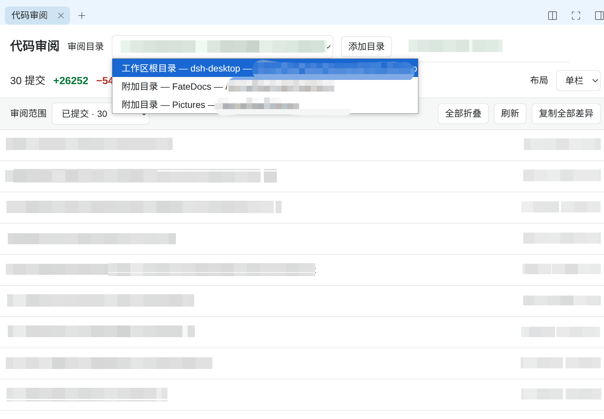
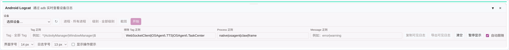

<h1 align="center">fate-dev DSH Desktop</h1>

A community extension of <a href="https://github.com/anywhere-labs/dsh-desktop">upstream DSH Desktop</a> for code workspaces, file review, Git, and Android debugging.

## Navigation

- [Changes from upstream](#changes-from-upstream)
- [Screenshots](#screenshots)
- [Local Profile plugins](#local-profile-plugins)
- [Downloads](#downloads)
- [Code changes / Release Note](#code-changes--release-note)
- [Security and privacy](#security-and-privacy)

## Changes from upstream

One-line summary for each feature:

| Feature | Summary |
| --- | --- |
| Multi-directory workspaces | Manage the primary directory and attached code directories in one session without changing the Agent session context when browsing roots. |
| Files tree shortcuts | Reveal files in the system manager, open them in VS Code, copy paths, or insert structured file references into a conversation. |
| Git Review | Review committed changes for the current session and switch between authorized workspace roots. |
| Editable Git workspace | Perform Git workspace operations in Desktop while keeping the Git panel and review directory independent. |
| GitHub Copilot | Sign in with a GitHub device code and use available Copilot models from the model picker. |
| Android Logcat | Select an adb device, filter live logs, pause or resume output, copy or export visible logs, and capture a device screenshot. |
| Session and file safety | File references stay structured, and README/review screenshots contain no sessions, memory databases, credentials, or access tokens. |

## Local Profile plugins

The following third-party plugins are currently installed and enabled in the local `desktop` Profile; versions come from the local Profile manifest.

| Plugin | Version | Role |
| --- | ---: | --- |
| `@michengai/dsh-archive-manager` | 1.0.16 | Archive management |
| `@michengai/dsh-automation` | 0.1.61 | Task automation |
| `@michengai/dsh-btw` | 0.1.18 | BTW extension |
| `@michengai/dsh-skills-manager` | 1.1.13 | Skills management |
| `@smalltailqwq/dsh-client-ui-skin-maid-atelier` | 0.1.7 | Client theme |
| `@wxg-prc-cpg/browser-skill-dsh-plugin` | 0.3.2 | Browser automation skill |
| `billion-context` | 0.1.181 | Context enhancement |
| `dsh-dream-skin` | 10.10.0 | UI theme |
| `dsh-ffmpeg` | 0.4.5 | Audio/video processing |
| `dsh-figma-mcp` | 0.6.0 | Figma MCP integration |
| `dsh-file-review` | 0.8.8 | File review |
| `dsh-ide-git` | 0.16.3 | Git panel |
| `dsh-image-viewer` | 0.1.9 | Image viewer |
| `dsh-prompt` | 0.4.9 | Prompt tools |
| `dsh-rewind-plugin` | 0.15.3 | Session rewind |
| `dsh-session-recycle-bin` | 0.4.3 | Session recycle bin |
| `meow-memory` | 0.31.0 | Cross-session memory |

## Downloads

The current Release keeps only the Stable channel:

| Version | Debian / Ubuntu |
| --- | --- |
| Stable 2.0.17 | [Download `.deb`](https://github.com/FateFeng/dsh-desktop/releases/download/v2.0.17-fate-dev/DSH-Desktop-2.0.17-amd64.deb) |

This project will no longer distribute AppImage builds; only the verifiable Debian / Ubuntu Stable package is maintained.

- Release page: <https://github.com/FateFeng/dsh-desktop/releases/tag/v2.0.17-fate-dev>
- Debian SHA-256: `2915f6ed9be7beddf42159c9553f1d1473f99b06982e663fa3236356f2a28479`
- Verified `.deb` asset size: 242,430,032 bytes.

## Code changes / Release Note

### 2.0.17-fate-dev

- `5fced936e9`: merged the Git Review worktree into `fate-dev`.
- `f7c3d06b81`: added session-scoped Git Review with attached workspace roots.
- `97291e91c9`: integrated editable Git workspace tools.
- `70962df847`: fixed inserting file references at the cursor.
- `91efd87d8d`: required absolute file paths in Assistant output.
- `6458eff142`: persisted workspace sources and integrated Desktop workspace features.
- `7300dd918c`: added Files tree context-menu shortcuts.
- `de3b76afbc`: added GitHub Copilot provider support and Android Logcat filter memory.
- `b125d0203d`: bumped Desktop versions to `2.0.17`.
- `9765a12e67`: added README, Git Review screenshots, plugin inventory, and Stable download notes.

## Security and privacy

- Local paths, repository details, and personal information in README screenshots have been redacted.
- The documentation records package names and versions only, not local directories, accounts, session contents, or plugin configuration.
- Check new screenshots and build artifacts before publishing so local sessions, the memory database, credentials, or access tokens are not included in the repository or Release.

## Screenshots

### Multi-directory workspaces

### Files tree shortcuts

### Git Review and code review

<table>
  <tr>
    <td width="43%"></td>
    <td width="57%"></td>
  </tr>
</table>

### GitHub Copilot

### Android Logcat

Original interface captures are in <a href="dsh-plugin-desktop/docs/screenshots/">dsh-plugin-desktop/docs/screenshots/</a>.

