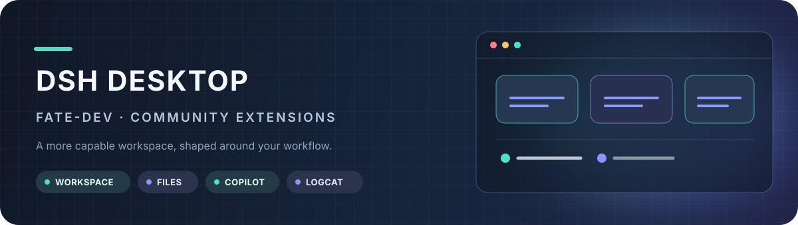
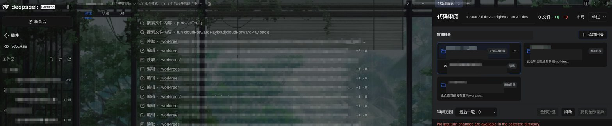

<h1 align="center">fate-dev DSH Desktop</h1>

A community extension of <a href="https://github.com/anywhere-labs/dsh-desktop">upstream DSH Desktop</a> for code workspaces, file review, Git, and Android debugging.

## Navigation

- [Changes from upstream](#changes-from-upstream)
- [Local Profile plugins](#local-profile-plugins)
- [Local configuration](#local-configuration)
- [Downloads](#downloads)
- [Code changes / Release Note](#code-changes--release-note)
- [Security and privacy](#security-and-privacy)
- [Screenshot](#screenshot)

## Changes from upstream

One-line summary for each feature:

| Feature | Summary |
| --- | --- |
| Multi-directory workspaces | Manage the primary directory and attached directories from the Workspace edit dialog; the Files browser switches independent roots without changing the session's working directory, and detaching a directory never deletes it from disk. |
| Files tree shortcuts | Reveal files in the system manager, open them in VS Code, copy paths, or insert structured file references into a conversation. |
| Git Review | Review changes for the current session; switch between the primary and attached roots, and expand the Git worktrees under each root to choose the review scope. |
| Editable Git workspace | Perform Git workspace operations in Desktop while keeping the Git panel and review directory independent. |
| GitHub Copilot | Sign in with a GitHub device code and use available Copilot models from the model picker. |
| Android Logcat | Select an adb device, filter live logs, pause or resume output, copy or export visible logs, and capture a device screenshot. |
| Goal-round loop containment | When auto-continuing goal rounds stop producing new evidence, or one identical call keeps repeating, Desktop first halts the continuation and asks the model to analyse the stall; the goal is only marked blocked once the intervention budget runs out. |
| Host process isolation | The Host Cordis root runs in its own Electron Node-mode child instead of Chromium's Utility process allocator, and an unexpected Host exit never replays in-flight work. |
| Session and file safety | File references stay structured, and README/review screenshots contain no sessions, memory databases, credentials, or access tokens. |

## Local Profile plugins

Versions come from the local Profile manifest at `~/.dsh/profiles/desktop/package.json`; only plugins currently declared and enabled are listed.

| Plugin | Version | Role |
| --- | ---: | --- |
| `dsh-byte-guard-recovery` | 0.1.0 (in-repo `file:` plugin) | When a request body exceeds the byte fuse or the endpoint returns 413, prune and compact in place and retry in the same session |
| `dsh-mnemon` | 0.5.30 | Composable layered memory, with provider / strategy / source sub-packages |
| `dsh-rewind-plugin` | 0.15.3 | In-window conversation rewind with workspace file restore |
| `dsh-session-recycle-bin` | 0.4.3 | Session trash: sidebar delete icon, multi-select restore or permanent delete, active-session protection |
| `dsh-dream-skin` | 10.10.0 | UI theme pack |
| `dsh-mermaid` | 0.4.1 | Render Mermaid blocks with a diagram/code toggle |
| `dsh-ffmpeg` | 0.4.5 | Process existing audio and video through natural-language FFmpeg calls |
| `@linxin666/dsh-client-ui-git-graph` | 0.4.6 | Git branch picker for a blank session plus the commit graph |

The Profile bundle order also includes the official packages `@deepseek-ai/dsh-base`, `@deepseek-ai/dsh-web-app`, `@deepseek-ai/dsh-experimental-auto-review`, and `dshmarket`. `dsh-byte-guard-recovery` exists only as a `file:` dependency inside the Profile directory and is not shipped inside the installer.

## Local configuration

The configuration snapshot lives at [`config/desktop-profile/cordis.patch.yml`](config/desktop-profile/cordis.patch.yml) and records the settings themselves, without credential values or local paths. What is currently active:

| Setting | Active value | Why |
| --- | --- | --- |
| Desktop shell | `mode: compatibility`, macOS material `transparent`, Windows material `off`, `networkExposure: loopback`, `openBrowser: true` | Compatibility mode runs the upstream default frontend; only the loopback interface is exposed, never the LAN |
| Notifications | turn completion/failure, job completion/failure, and schedule completion/failure all `true` | Long tasks pull you back to the session through notifications |
| Default model | `github-copilot` / `gpt-6-sol` | The default landing point of the model picker |
| Permission presets | default `danger-full-access` (full sandbox, `approval: never`), plus `read-only` and `workspace-write` presets kept as `ask` | This is a local development machine; the presets remain switchable in Settings |
| Request body caps | Copilot image 1 MiB, total request 2 MiB | Pairs with the `dsh-byte-guard-recovery` byte fuse, which prunes before the endpoint rejects |
| Context compaction | `compaction-basic`, `tool-result-pruner`, and `command-compact` all explicitly `disabled: false` | The upstream Web carrier disables them by default and patches merge shallowly, so they must be turned on explicitly; kimi-k3 compacts at 0.35 of the window and retains 0.08, ahead of the 2 MiB byte fuse |
| Memory | `dsh-mnemon` remote access `read-only`, local embedding off, `strict-v1` recall policy, three-tier memory view | No extra local vector service is started |
| Interface | theme follows the system, font size 17, developer tools on, process and usage views `detailed` | Troubleshooting needs the full process and usage detail |
| Session logging | `@deepseek-ai/dsh-session-log-deepseek` `enabled: false` | Session content never lands in logs |

Two notes:

- API keys are referenced only by environment variable name (for example `XIAOMI_TOKEN_PLAN_CN_API_KEY`); no key value is committed.
- The live Profile still carries a `@zhangfengshun/dsh-remote-ssh` entry whose plugin is no longer in the manifest, which prints an "entry not found" warning at startup. The repository snapshot omits that block because it contains an internal address and a private key path.

## Downloads

The current Release keeps only the Stable channel:

| Version | Debian / Ubuntu |
| --- | --- |
| Stable 2.0.17 | [Download `.deb`](https://github.com/FateFeng/dsh-desktop/releases/download/v2.0.17-fate-dev/DSH-Desktop-2.0.17-amd64.deb) |

This project will no longer distribute AppImage builds; only the verifiable Debian / Ubuntu Stable package is maintained.

- Release page: <https://github.com/FateFeng/dsh-desktop/releases/tag/v2.0.17-fate-dev>
- Debian SHA-256: `2915f6ed9be7beddf42159c9553f1d1473f99b06982e663fa3236356f2a28479`
- Verified `.deb` asset size: 242,430,032 bytes.

## Code changes / Release Note

### Aligned with the upstream repository (2026-11-05)

- Local `master` was first synced with <https://github.com/anywhere-labs/dsh-desktop> and then merged into `fate-dev`, bringing in 48 upstream commits: Beta and Next both moved to DeepSeek Harness `0.2.2-rc.1`, the submodule pin became `66491b05e3` (matching the active channel in `upstream.json`), `vendor/dsh-runtime/0.2.2-rc.1/`, the `@0.2.2-rc.1` files under `patches/` and Next's packaging scripts were updated, and the retired runtime snapshots and patches under `_deprecated/` were removed.
- Channel choice: Stable stays on `0.2.2-alpha.2` (the installed 2.0.17 package and the 71 locally changed Stable source files were validated against that runtime), while Beta and Next take upstream's `0.2.2-rc.1`. The root `package.json` `resolutions` therefore keeps both vendor maps, alpha.2 and rc.1, and the local `dsh-ide-git` and `@earendil-works/pi-ai` patch maps are unchanged; the `0.2.1-rc.5` map was dropped when Next moved up.
- `dsh-community-market` peer compatibility now reads `0.2.1-rc.3 || 0.2.2-alpha.2 || 0.2.2-rc.1` (Cordis `4.0.5 || 4.0.6-alpha.1 || 4.1.0`), and `tests/contracts.spec.ts` was updated to match. The package remains a documentation scaffold with no loadable entry point.
- Beta and Next now follow the same upstream release and must mirror each other exactly: the `paths` block in `dsh-desktop-next/tsconfig.json` lost its `next-lead` markers and was synced into `dsh-plugin-desktop-beta/tsconfig.json`; `corepack yarn check:desktop-variants` aligns 359 files.
- Upstream deleted the `0.2.2-alpha.2` runtime patches, which Stable still needs, so the 31 `patches/*@0.2.2-alpha.2.patch` files were restored to the working tree.
- Upstream's README badges, download table and plugin-ecosystem sections were not merged: this community README keeps `fate-dev`'s content (feature table, local Profile plugins, local configuration, local change record, and the single screenshot).
- Gate status: `corepack yarn install --immutable`, `yarn test`, `yarn typecheck` (Beta / Market / Next), `check:desktop-variants` and `check:bilingual-docs` are green. `dsh-plugin-desktop`'s own typecheck is still red on `sidebar.workspaces.workspace.edit` — that slot exists only in unpublished harness source and is in neither released runtime — and `check:layout` is still red on `dsh-plugin-desktop` depending on `dsh-ide-git: workspace:*`. Both were already red before this merge, and neither gate runs in CI's packaging pipeline.

### Merge with the cloud 0.2.2-alpha.2 line (`ce00e94318`, 2026-11-05)

- The runtime moved to `0.2.2-alpha.2`, the upstream patch series was redone against cloud's versions, and the `patches/` `patch:` files and `yarn.lock` were aligned together.
- The Beta channel migrated to the dsh-desktop-next framework: 61 legacy files were removed from `dsh-plugin-desktop-beta`, and their content still lives in `dsh-plugin-desktop` or in the pre-merge snapshot `cb23a018b0`. `corepack yarn check:desktop-variants` now compares Next against Beta.
- Everywhere cloud already had an implementation, cloud's version wins, including Git Review multi-root, attached directories, goal-round loop containment, Host process isolation, and renderer crash diagnostics.

### Local changes on top of cloud (2026-11-05)

| Change | Location | Notes |
| --- | --- | --- |
| Multi-worktree repository scan | [`dsh-ide-git/src/index.js:1501`](dsh-ide-git/src/index.js) | Repository enumeration skips every dot directory by default; `.worktrees` is allow-listed so the Git panel and Git Review can discover sibling worktrees. Covered by `dsh-ide-git/tests/repos.test.mjs` |
| Byte-fuse recovery plugin | [`config/desktop-profile/plugins/dsh-byte-guard-recovery/`](config/desktop-profile/plugins/dsh-byte-guard-recovery/) | Prunes and compacts an oversized request body in place, then retries; ships three tests for the recovery ladder, the compaction invariant, and the real surface fold |
| Crashpad minidump evidence | [`dsh-plugin-desktop/src/crashpad-evidence.ts`](dsh-plugin-desktop/src/crashpad-evidence.ts) | Parses local minidump headers so a diagnostic export lists metadata only; dumps never leave the machine |
| Node-mode Host and attached-root tests | `dsh-plugin-desktop/tests/host-process-node-mode.spec.ts`, `dsh-plugin-desktop/tests/workspace-sources-root-switch.spec.tsx` | Cover Host RPC over the separate child process, and keying the Files tree selection by the session cwd after it moves to an attached root |
| Local upstream patch archive | [`patches/upstream/`](patches/upstream/) | rc.2 0014 (session persistence must not read data written by a newer harness) and 0015 (seed the composer only from a usable draft), plus the rc.2 and rc.5 worktree snapshots |
| Profile configuration snapshot | [`config/desktop-profile/cordis.patch.yml`](config/desktop-profile/cordis.patch.yml) | See the Local configuration section |
| Layout gate now lists the sixth workspace | [`scripts/verify-layout.mjs:33`](scripts/verify-layout.mjs) | The root `workspaces` array already contains `dsh-ide-git`; the expected list was missing it |
| Optional electron-builder launcher | [`dsh-plugin-desktop/scripts/package-linux.ts:63`](dsh-plugin-desktop/scripts/package-linux.ts) | The local argv-normalizing launcher is now optional and the CLI is invoked directly without it, so upstream's new `package-targets.spec.ts` fixtures pass without the field |

### 2.0.17-fate-dev

- Workspace edit can add or detach attached directories, and the Files browser switches between the primary and attached roots independently; the Git Review root tree expands Git worktrees under each Workspace source, and switching the review root or worktree keeps the current session scope, with retry on enumeration failure.
- `5fced936e9`: merged the Git Review worktree into `fate-dev`.
- `f7c3d06b81`: added session-scoped Git Review with attached workspace roots.
- `97291e91c9`: integrated editable Git workspace tools.
- `70962df847`: fixed inserting file references at the cursor.
- `91efd87d8d`: required absolute file paths in Assistant output.
- `6458eff142`: persisted workspace sources and integrated Desktop workspace features.
- `7300dd918c`: added Files tree context-menu shortcuts.
- `de3b76afbc`: added GitHub Copilot provider support and Android Logcat filter memory.
- `b125d0203d`: bumped Desktop versions to `2.0.17`.
- `9765a12e67`: added README, Git Review screenshots, plugin inventory, and Stable download notes.

## Security and privacy

- The README keeps a single screenshot, and the local paths, repository names, and directory details inside it are masked.
- Documentation records package names, versions, and setting names only, not local directories, internal addresses, accounts, session contents, or plugin configuration values.
- `config/desktop-profile/cordis.patch.yml` records settings only; credentials stay referenced by environment variable name, and fragments containing private key paths or internal addresses are not committed.
- Check new screenshots and build artifacts before publishing so local sessions, the memory database, credentials, or access tokens are not included in the repository or Release.

## Screenshot

### Attached directories and Git Review worktree selection

The plugin's own interface captures remain in <a href="dsh-plugin-desktop/docs/screenshots/">dsh-plugin-desktop/docs/screenshots/</a>.

