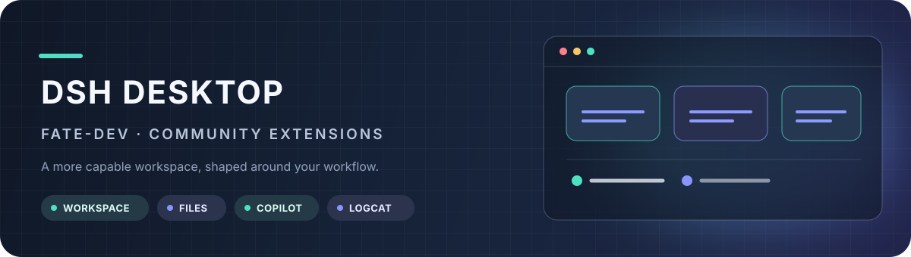
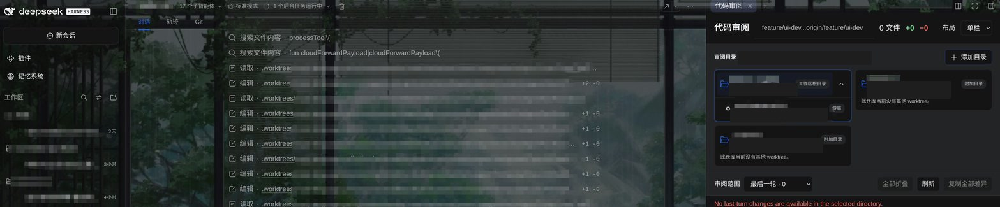

<h1 align="center">fate-dev DSH Desktop</h1>

A community extension of <a href="https://github.com/anywhere-labs/dsh-desktop">upstream DSH Desktop</a> for code workspaces, file review, Git, and Android debugging.

## Navigation

- [Changes from upstream](#changes-from-upstream)
- [Local Profile plugins](#local-profile-plugins)
- [Local configuration](#local-configuration)
- [Downloads](#downloads)
- [Code changes / Release Note](#code-changes--release-note)
- [Security and privacy](#security-and-privacy)
- [Screenshot](#screenshot)

## Changes from upstream

One-line summary for each feature:

| Feature | Summary |
| --- | --- |
| Multi-directory workspaces | Manage the primary directory and attached directories from the Workspace edit dialog; the Files browser switches independent roots without changing the session's working directory, and detaching a directory never deletes it from disk. |
| Files tree shortcuts | Reveal files in the system manager, open them in VS Code, copy paths, or insert structured file references into a conversation. |
| Git Review | Review changes for the current session; switch between the primary and attached roots, and expand the Git worktrees under each root to choose the review scope. |
| Editable Git workspace | Perform Git workspace operations in Desktop while keeping the Git panel and review directory independent. |
| GitHub Copilot | Sign in with a GitHub device code and use available Copilot models from the model picker. |
| Android Logcat | Select an adb device, filter live logs, pause or resume output, copy or export visible logs, and capture a device screenshot. |
| Goal-round loop containment | When auto-continuing goal rounds stop producing new evidence, or one identical call keeps repeating, Desktop first halts the continuation and asks the model to analyse the stall; the goal is only marked blocked once the intervention budget runs out. |
| Host process isolation | The Host Cordis root runs in its own Electron Node-mode child instead of Chromium's Utility process allocator, and an unexpected Host exit never replays in-flight work. |
| Session and file safety | File references stay structured, and README/review screenshots contain no sessions, memory databases, credentials, or access tokens. |

## Local Profile plugins

Versions come from the local Profile manifest at `~/.dsh/profiles/desktop/package.json`; only plugins currently declared and enabled are listed.

| Plugin | Version | Role |
| --- | ---: | --- |
| `dsh-byte-guard-recovery` | 0.1.0 (in-repo `file:` plugin) | When a request body exceeds the byte fuse or the endpoint returns 413, prune and compact in place and retry in the same session |
| `dsh-mnemon` | 0.5.30 | Composable layered memory, with provider / strategy / source sub-packages |
| `dsh-rewind-plugin` | 0.15.3 | In-window conversation rewind with workspace file restore |
| `dsh-session-recycle-bin` | 0.4.3 | Session trash: sidebar delete icon, multi-select restore or permanent delete, active-session protection |
| `dsh-dream-skin` | 10.10.0 | UI theme pack |
| `dsh-mermaid` | 0.4.1 | Render Mermaid blocks with a diagram/code toggle |
| `dsh-ffmpeg` | 0.4.5 | Process existing audio and video through natural-language FFmpeg calls |
| `@linxin666/dsh-client-ui-git-graph` | 0.4.6 | Git branch picker for a blank session plus the commit graph |

The Profile bundle order also includes the official packages `@deepseek-ai/dsh-base`, `@deepseek-ai/dsh-web-app`, `@deepseek-ai/dsh-experimental-auto-review`, and `dshmarket`. `dsh-byte-guard-recovery` exists only as a `file:` dependency inside the Profile directory and is not shipped inside the installer. `dsh-rewind-plugin` over-long snapshot names (ENAMETOOLONG; upstream still caps nothing through 0.20.0) are fixed in the installed Profile copy by `config/desktop-profile/patches/dsh-rewind-plugin@0.15.3-name-cap.patch`, which has to be re-applied after a plugin upgrade; `scripts/rewind-snapshot-name-cap.test.mjs` fails when the patch is missing.

## Local configuration

The configuration snapshot lives at [`config/desktop-profile/cordis.patch.yml`](config/desktop-profile/cordis.patch.yml) and records the settings themselves, without credential values or local paths. What is currently active:

| Setting | Active value | Why |
| --- | --- | --- |
| Desktop shell | `mode: compatibility`, macOS material `transparent`, Windows material `off`, `networkExposure: loopback`, `openBrowser: true` | Compatibility mode runs the upstream default frontend; only the loopback interface is exposed, never the LAN |
| Notifications | turn completion/failure, job completion/failure, and schedule completion/failure all `true` | Long tasks pull you back to the session through notifications |
| Default model | `github-copilot` / `gpt-6-sol` | The default landing point of the model picker |
| Permission presets | default `danger-full-access` (full sandbox, `approval: never`), plus `read-only` and `workspace-write` presets kept as `ask` | This is a local development machine; the presets remain switchable in Settings |
| Request body caps | Copilot image 1 MiB, total request 2 MiB | Pairs with the `dsh-byte-guard-recovery` byte fuse, which prunes before the endpoint rejects |
| Context compaction | `compaction-basic`, `tool-result-pruner`, and `command-compact` all explicitly `disabled: false` | The upstream Web carrier disables them by default and patches merge shallowly, so they must be turned on explicitly; kimi-k3 compacts at 0.35 of the window and retains 0.08, ahead of the 2 MiB byte fuse |
| Memory | `dsh-mnemon` remote access `read-only`, local embedding off, `strict-v1` recall policy, three-tier memory view | No extra local vector service is started |
| Interface | theme follows the system, font size 17, developer tools on, process and usage views `detailed` | Troubleshooting needs the full process and usage detail |
| Session logging | `@deepseek-ai/dsh-session-log-deepseek` `enabled: false` | Session content never lands in logs |

Two notes:

- API keys are referenced only by environment variable name (for example `XIAOMI_TOKEN_PLAN_CN_API_KEY`); no key value is committed.
- The live Profile still carries a `@zhangfengshun/dsh-remote-ssh` entry whose plugin is no longer in the manifest, which prints an "entry not found" warning at startup. The repository snapshot omits that block because it contains an internal address and a private key path.

## Downloads

The current Release keeps only the Stable channel:

| Version | Debian / Ubuntu |
| --- | --- |
| Stable 2.0.17 | [Download `.deb`](https://github.com/FateFeng/dsh-desktop/releases/download/v2.0.17-fate-dev/DSH-Desktop-2.0.17-amd64.deb) |

This project will no longer distribute AppImage builds; only the verifiable Debian / Ubuntu Stable package is maintained.

- Release page: <https://github.com/FateFeng/dsh-desktop/releases/tag/v2.0.17-fate-dev>
- Debian SHA-256: `2915f6ed9be7beddf42159c9553f1d1473f99b06982e663fa3236356f2a28479`
- Verified `.deb` asset size: 242,430,032 bytes.

`2.0.18` and `2.0.19` were built locally on `fate-dev` only and are not published to Releases:

| Version | Local artifact | Status |
| --- | --- | --- |
| 2.0.19 | `dsh-plugin-desktop/dist/DSH-Desktop-2.0.19-amd64.deb` (361,862,744 bytes, SHA-256 `25dad9d934691ef27fd631f74aab7977f3812a8ad789aa605ebc7a9e0ca6e447`) | First package with the image pipeline on sharp 0.33.5; after extraction `resources/app/node_modules/sharp` reports `0.33.5` and libvips ships `libvips-cpp.so.42`; also built by `./scripts/build-ubuntu.sh`, so it carries the local runtime overlay and is for local verification only |
| 2.0.18 | `dsh-plugin-desktop/dist/DSH-Desktop-2.0.18-amd64.deb` (363,598,336 bytes, SHA-256 `d40534c09bc75b6360502beb0f5580249b6c091049f1015ec3f9852974036b35`) | Built by `./scripts/build-ubuntu.sh`; the submodule was checked out on the local series branch at the time, so the package carries a local runtime overlay and is for local verification only |

## Code changes / Release Note

### Host image pipeline moved back to sharp 0.33.5 (2026-11-06, 2.0.19)

- What happened: the Host utility process was killed by SIGTRAP (`lifecycle-events/startup.jsonl` records `exitCode: 133`, `disposition: unexpected`, `uptimeMs: 8405111.834` on 2.0.18) and Crashpad kept a single minidump (`6abe6e81-48e9-41e8-bae8-f4374fd4fca9.dmp`, `pid=2123571`, `code=0x5`, `module=dsh-desktop +0x93dcba8`). The 12:06 crash the same day under 2.0.17 has the same signature, so aligning the channels on rc.1 is not the cause. Over the same window the log accumulated 14,784 lines of `GLib-GObject-CRITICAL … g_object_ref/g_object_unref: assertion 'G_IS_OBJECT (object)' failed`, the last batch 10 ms before the crash.
- Measured boundary: one identical three-step image operation (`metadata()` + full `raw()` decode + `rotate().toColourspace('srgb').resize().png()`) inside Electron's Node mode reports 279 lines with sharp 0.35.5 (libvips 8.18.7), 156 with sharp 0.34.2 (libvips 8.16.x) and 6 with sharp 0.33.5 (libvips 8.15.3) — and the 0.33.5 run has no GObject assertion at all. Plain node runs the same script with 0 lines. All three produce byte-identical output, so this is a linking conflict rather than a capability difference.
- Where the conflict comes from: `ldd` on the installed binary shows Electron linking the system `libglib/libgobject/libgio` 2.80, while `@img/sharp-libvips-linux-x64`'s `libvips-cpp.so` statically bundles its own glib and exports 1672 `g_*` symbols; two GObject runtimes in one process end up pointing at each other's objects. Levers that were tried and did nothing: `LD_PRELOAD` of the bundled libvips, `LD_PRELOAD` of the system `libgobject/libglib/libgio`, and `SHARP_IGNORE_GLOBAL_LIBVIPS=1` — all still flood.
- Configuration cannot dodge it: `canPassThroughNormalization` at `@deepseek-ai/dsh-attachment-local/lib/index.js:213` requires, besides the three size limits, that the source is not a gif, not animated, `!carriesMetadata`, `depth === "uchar"` and `space === "srgb"`, so any screenshot with metadata enters sharp no matter how small; and `detectImage` at line 186 does a full `image.raw().toBuffer()` decode for every admitted image, so "never load sharp" is not reachable inside upstream's pipeline. Also correcting the earlier note: `github-copilot.maxRequestImageBytes` in `config/desktop-profile/cordis.patch.yml` is only a snapshot of the local Profile (the live file is `~/.dsh/profiles/desktop/cordis.patch.yml`, and layer order is bundles → profile → home, see `dsh-plugin-desktop/src/profile.ts:1700-1703`); it ships in no artifact and takes no part in the normalization decision.
- What actually changed (all compiled into the package): the root `package.json` `resolutions` gained `"sharp@npm:0.35.5": "0.33.5"` — upstream's `@deepseek-ai/dsh-attachment-local` depends on `sharp: 0.35.5` exactly, so rerouting is the only lever; `scripts/prepare-local-runtime.mjs` would otherwise reject the local overlay with `... needs sharp@0.35.5, but Desktop resolves 0.33.5`, so it gained 14 added-only lines of `desktopDependencyOverrides` that pass only when the resolved version equals the recorded one and stay strict for every other dependency; `dsh-plugin-desktop/package.json` now declares its own `0.33.5` and the product version moved `2.0.18` → `2.0.19`; and `scripts/mac-universal.ts` hardcodes the macOS native names as 0.33.5 really ships them — `node_modules/@img/sharp-darwin-{arm64,x64}/lib/sharp-darwin-{arm64,x64}.node` and `node_modules/@img/sharp-libvips-darwin-{arm64,x64}/lib/libvips-cpp.42.dylib`. All four workspaces (Desktop / Beta / Next / Market) resolve to `0.33.5`.
- The only assertion that had to shrink is a redundant one: `bitsPerSample` is metadata that sharp added in 0.34 and 0.33.5 does not return, while the 16-bit guarantee is already pinned by `space: 'rgb16'` and `depth: 'ushort'`, so that single field was removed from the macOS icon case in `tests/package.spec.ts` and from the entry checks in `scripts/generate-mac-app-icon.mjs` and `scripts/generate-windows-app-icon.mjs`; every other field (`channels/hasAlpha/icc`, the 824x824 trim and its `-100/-100` offsets) measured identical on both versions.
- Self-proof: calling the real `normalizeImage` export of `@deepseek-ai/dsh-attachment-local` with `carriesMetadata: true` to force the sharp ladder gives identical results on 0.35.5 and 0.33.5 (`image/jpeg 2364x1773`, 1,354,217 bytes) while assertions drop from 279 lines to 6.
- Cost and uncovered ground: libvips steps back from 8.18.7 to 8.15.3 and its bundled components follow (`uhdr` is gone, `xml2` reverts to `xml`, aom 3.15.1→3.9.1, heif 1.23.5→1.18.2, webp 1.6.0→1.4.0, mozjpeg commit→4.1.5), so HDR and newer decoders cover less; 6 `g_datalist_id_set_data_full: assertion 'key_id > 0' failed` lines remain; between the flood and the SIGTRAP all we proved is "the flood was still streaming when it died" plus "this is the only variable that measurably differs", and `dsh-desktop +0x93dcba8` is still unresolved — this release is containment, not a confirmed root-cause fix.

### All three channels on 0.2.2-rc.1 (2026-11-06)

- `upstream.json` now records the same upstream commit `66491b05e3` (tag `dsh-v0.2.2-rc.1`) for stable / beta / next, with `sourceVersion` and `runtimePackageVersion` both `0.2.2-rc.1` and `runtimeSource` pointing at `vendor/dsh-runtime/0.2.2-rc.1/manifest.json`; `activeChannel` is still `beta`. The "Stable stays on alpha.2" trade-off in the section below ends here.
- The dependency graph collapsed accordingly: root `package.json` `resolutions` went from 1504 to 764 entries, `patches/` from 102 `.patch` files to 47 (36 `@0.2.2-rc.1` runtime patches plus 11 third-party ones), deleting the 31 `0.2.2-alpha.2` files and the `0.2.1-rc.3` batch together; `dsh-community-market`'s peer string collapsed from three values to a single `0.2.2-rc.1` (Cordis still declares `4.0.5 || 4.0.6-alpha.1 || 4.1.0` and resolves to `4.1.0`). `yarn.lock` was regenerated and `node scripts/sync-vendored-runtime.mjs --check` is green for all three channels.
- The single failure reported below (`tests/host-process-integration.spec.ts`, AA enabled: true) passes on rc.1: the Agents Anywhere bridge peer string now covers the runtime Stable uses. `corepack yarn workspace dsh-plugin-desktop test` runs 2103 cases with zero failures (2091 passed, 12 skipped).
- `dsh-plugin-desktop`'s own typecheck error on `sidebar.workspaces.workspace.edit` disappeared with the local series moving onto rc.1 — that slot is declared by the local harness series, so the test fixtures only had a type to read once the runtime carried it.
- The settings sidebar icon no longer needs a patch. rc.1's settings shell exposes the `settings.section.icon` slot (`packages/client/ui-settings/src/client/contract/slots.ts`, addressed by the `settings.section` id), and the Desktop icon registers into it: [`dsh-plugin-desktop/src/client/DesktopSettingsIcon.tsx`](dsh-plugin-desktop/src/client/DesktopSettingsIcon.tsx), called from `src/client/desktop-settings.ts` right after the section registration. `patches/dsh-client-ui-settings-general@0.2.2-alpha.2.patch` was therefore not re-recorded, and `tests/package.spec.ts` now asserts that this package stays unpatched.
- Cordis 4.1.0 moved the fiber of `internal/config` into the first parameter (`@deepseek-ai/cordis/lib/types/events.d.ts:229` declares `'internal/config'(fiber: Fiber, next: () => any)`), so the composition check in [`dsh-plugin-desktop/src/settings-bridge.ts:264`](dsh-plugin-desktop/src/settings-bridge.ts) reads that parameter instead of `this`. The two Workspace test fixtures gained the new session-scoped standard props (`useContextMenu`, `useAccess`, `useConversation`, `useInput`, `inputActions`). rc.1's sidebar root also gained a `drawer` mode (`@deepseek-ai/dsh-client-ui-sidebar/lib/client.js` uses it to decide whether the sidebar is always mounted), so `src/client/AdvancedFrame.tsx` now passes `drawer: false` explicitly in the Desktop-owned shell.
- `scripts/prepare-local-runtime.mjs`: `restorePinnedPackage` first checks whether the channel still installs that package and returns immediately if it does not. Upstream removed `@deepseek-ai/dsh-client-ui-deepseek-model-label-1017` in `0.2.1-rc.2`, but the overlay cache still had the old name; in the previous order that required a vendor manifest record first and then failed with `pinned runtime manifest has no ...`.
- The replay archive of the local harness series on rc.1 is `patches/upstream/0.2.2-rc.1/worktree-snapshot-20261106.patch` (116 files, +2793/−188, equal to `git diff 66491b05e3..013e5314e0`); which local changes upstream absorbed and which decisions rc.1's API drift forced is recorded in [`patches/upstream/README.md`](patches/upstream/README.md). The submodule still records the official pin `66491b05e3`, while this machine's worktree is checked out on the local branch `local-series-0.2.2-rc.1`, so `./scripts/build-ubuntu.sh` prints the "local upstream overlay" warning — such packages are for local verification only and cannot be release artifacts.
- Gate status: `corepack yarn install --immutable`, `yarn typecheck`, `check:desktop-variants` (Next ↔ Beta aligned across 359 files), `check:bilingual-docs`, and `dsh-plugin-desktop`'s `build` / `typecheck` / `test` are all green; after re-recording the 5 stale pairing records with `pnpm run verify-translation-pairing --write`, all 1164 pairs in the submodule match. `check:layout` is still red on `stable desktop dependencies.dsh-ide-git bypasses the published DSH package boundary`, and `corepack yarn aa:check` still reports that the recorded AA artifact is not from the latest AA `main` (currently `8183fb563c`); neither is related to this alignment and neither runs in CI's packaging pipeline.
- The installer grew because of upstream, not the local overlay: this generation adds `extraResources` for the linux target too (`.desktop-build/runtime` → `resources/runtime`, under `build.linux` in `dsh-plugin-desktop/package.json`), so the 2.0.18 `.deb` carries `resources/runtime/x64` (399,765,281 bytes, 7981 entries) where 2.0.17 had none; total entries went from 34,771 to 45,161.

### Aligned with the upstream repository (2026-11-05)

The following describes the state at that time; the entries about the Stable runtime, the AA failure and the gate status were superseded by "All three channels on 0.2.2-rc.1" above, and are kept to record why the choice was made then.

- Local `master` was first synced with <https://github.com/anywhere-labs/dsh-desktop> and then merged into `fate-dev`, bringing in 48 upstream commits: Beta and Next both moved to DeepSeek Harness `0.2.2-rc.1`, the submodule pin became `66491b05e3` (matching the active channel in `upstream.json`), `vendor/dsh-runtime/0.2.2-rc.1/`, the `@0.2.2-rc.1` files under `patches/` and Next's packaging scripts were updated, and the retired runtime snapshots and patches under `_deprecated/` were removed.
- Channel choice: Stable stays on `0.2.2-alpha.2` (the installed 2.0.17 package and the 71 locally changed Stable source files were validated against that runtime), while Beta and Next take upstream's `0.2.2-rc.1`. The root `package.json` `resolutions` therefore keeps both vendor maps, alpha.2 and rc.1, and the local `dsh-ide-git` and `@earendil-works/pi-ai` patch maps are unchanged; the `0.2.1-rc.5` and `0.2.1-rc.3` maps were dropped when Next moved up (688 rc.3 selectors) and `yarn.lock` was regenerated with them — `dsh-plugin-desktop/tests/package.spec.ts` requires every `@deepseek-ai/dsh*` selector to belong to a channel's recorded `sourceVersion`, so an unreferenced family fails the gate outright. (The two vendor maps here were collapsed into the single `0.2.2-rc.1` map above.)
- Staying on alpha.2 costs Agents Anywhere on Stable (superseded above: Stable is on `0.2.2-rc.1` now, so this bridge row is no longer disabled): upstream's bridge `@agents-anywhere/dsh-bridge-next@2.1.0-desktop.cc1883dad3ff4.r5dbd817f` accepts peers `0.2.1-rc.3 || 0.2.2-rc.1`, so alpha.2's plugin-compatibility gate disables that profile row and `tests/host-process-integration.spec.ts` (AA enabled: true) is red on this branch. The pre-merge local bridge (`r156e8f86`, peers `0.2.0-rc.2`) sat outside alpha.2 as well, so this is not a new regression; making AA work on Stable means moving the stable channel to `0.2.2-rc.1` and rebuilding the package (done above: the stable channel moved to `0.2.2-rc.1`).
- `dsh-community-market` peer compatibility now reads `0.2.1-rc.3 || 0.2.2-alpha.2 || 0.2.2-rc.1` (Cordis `4.0.5 || 4.0.6-alpha.1 || 4.1.0`), and `tests/contracts.spec.ts` was updated to match. The package remains a documentation scaffold with no loadable entry point.
- Beta and Next now follow the same upstream release and must mirror each other exactly: the `paths` block in `dsh-desktop-next/tsconfig.json` lost its `next-lead` markers and was synced into `dsh-plugin-desktop-beta/tsconfig.json`; `corepack yarn check:desktop-variants` aligns 359 files.
- Upstream deleted the `0.2.2-alpha.2` runtime patches, which Stable still needs, so the 31 `patches/*@0.2.2-alpha.2.patch` files were restored to the working tree (superseded above: they were deleted again once Stable moved to rc.1).
- `dsh-plugin-desktop/tests/package.spec.ts` now asserts the merged pi-ai graph: only two npm resolutions remain — `0.87.1` (Desktop's own Copilot catalog pin) and the patched `1.4.0` from `patches/pi-ai@1.4.0.patch` — and the root `pi-telemetry@npm:^1.1.0` guard keeps upstream's entry even though its only requester left with the rc.5 family, so the lock carries just the `0.87.1` and `1.4.0` copies each pi-ai declares.
- The Host talks to its supervisor over a different transport now: upstream moved `src/host-process-entry.ts` from `process.send` to `process.parentPort`, which only Electron's `utilityProcess.fork` (`src/host-process.ts:49`) publishes — under `child_process.fork` with `ELECTRON_RUN_AS_NODE` it is `undefined`. Both local tests were rewritten against the new contract: `host-process-node-mode.spec.ts` now asserts that a non-utility launch must refuse, and `workspace-sources-root-switch.spec.tsx` asserts that the Files tree switches only its own root and never calls back to move the session cwd.
- `dsh-plugin-desktop/lib/` had been built against the pre-merge local runtime overlay, so after `yarn install` restored the published packages `lib/profile-manager-*.js` was importing `PROFILE_TEMPLATES` from an alpha.2 `dsh-app-boot` that does not export it. The package was rebuilt with `tsdown` plus both `vite build` steps, and `DesktopWebServer.Config` gained an explicit type annotation because alpha.2's `dsh-llm` ships its own schemastery in Stable's tree and the inherited `Schema<Config>` cannot be named in a `.d.ts`.
- Upstream's README badges, download table and plugin-ecosystem sections were not merged: this community README keeps `fate-dev`'s content (feature table, local Profile plugins, local configuration, local change record, and the single screenshot).
- Gate status: `corepack yarn install --immutable`, `yarn typecheck` (Beta / Market / Next), `check:desktop-variants` and `check:bilingual-docs` are green; `corepack yarn workspace dsh-plugin-desktop test` has one failure left out of 2102 — the AA-enabled case above — so the root `yarn test` is red with it. `dsh-plugin-desktop`'s own typecheck is still red on `sidebar.workspaces.workspace.edit` — that slot exists only in unpublished harness source and is in neither released runtime — `check:layout` is still red on `dsh-plugin-desktop` depending on `dsh-ide-git: workspace:*`, and `corepack yarn aa:check` reports that the recorded AA artifact (`cc1883dad3ff4`) is behind AA `main` (`296f70ed4036`), so `aa:prepare-release` has to run before a release. The first two were already true before the merge, and none of these gates runs in CI's packaging pipeline. (The AA failure, the `sidebar.workspaces.workspace.edit` typecheck failure and the 2102 count here were superseded above.)

### Merge with the cloud 0.2.2-alpha.2 line (`ce00e94318`, 2026-11-05)

- The runtime moved to `0.2.2-alpha.2`, the upstream patch series was redone against cloud's versions, and the `patches/` `patch:` files and `yarn.lock` were aligned together.
- The Beta channel migrated to the dsh-desktop-next framework: 61 legacy files were removed from `dsh-plugin-desktop-beta`, and their content still lives in `dsh-plugin-desktop` or in the pre-merge snapshot `cb23a018b0`. `corepack yarn check:desktop-variants` now compares Next against Beta.
- Everywhere cloud already had an implementation, cloud's version wins, including Git Review multi-root, attached directories, goal-round loop containment, Host process isolation, and renderer crash diagnostics.

### Local changes on top of cloud (2026-11-05)

| Change | Location | Notes |
| --- | --- | --- |
| Multi-worktree repository scan | [`dsh-ide-git/src/index.js:1501`](dsh-ide-git/src/index.js) | Repository enumeration skips every dot directory by default; `.worktrees` is allow-listed so the Git panel and Git Review can discover sibling worktrees. Covered by `dsh-ide-git/tests/repos.test.mjs` |
| Byte-fuse recovery plugin | [`config/desktop-profile/plugins/dsh-byte-guard-recovery/`](config/desktop-profile/plugins/dsh-byte-guard-recovery/) | Prunes and compacts an oversized request body in place, then retries; ships three tests for the recovery ladder, the compaction invariant, and the real surface fold |
| Crashpad minidump evidence | [`dsh-plugin-desktop/src/crashpad-evidence.ts`](dsh-plugin-desktop/src/crashpad-evidence.ts) | Parses local minidump headers so a diagnostic export lists metadata only; dumps never leave the machine. `src/main.ts` now prints a one-line dump summary (exception code, module, offset, pid) when a child process ends as crashed/oom/launch-failed and when the previous run did not shut down cleanly, and the `host.exited` lifecycle event carries the Host pid so the record can be matched to the minidump Crashpad wrote |
| Node-mode Host and attached-root tests | `dsh-plugin-desktop/tests/host-process-node-mode.spec.ts`, `dsh-plugin-desktop/tests/workspace-sources-root-switch.spec.tsx` | Rewritten against upstream's new transport contract: one asserts that a launch outside Electron's `utilityProcess` must refuse and carry the supervisor error back, the other asserts the Files tree switches only its own root and that `selectRoot` receives a no-op callback that never moves the session cwd |
| Local upstream patch archive | [`patches/upstream/`](patches/upstream/) | rc.2 0014 (session persistence must not read data written by a newer harness) and 0015 (seed the composer only from a usable draft), plus the rc.2, rc.5 and rc.1 replay snapshots; the rc.1 one is `0.2.2-rc.1/worktree-snapshot-20261106.patch` |
| Profile configuration snapshot | [`config/desktop-profile/cordis.patch.yml`](config/desktop-profile/cordis.patch.yml) | See the Local configuration section |
| Layout gate now lists the sixth workspace | [`scripts/verify-layout.mjs:33`](scripts/verify-layout.mjs) | The root `workspaces` array already contains `dsh-ide-git`; the expected list was missing it |
| Optional electron-builder launcher | [`dsh-plugin-desktop/scripts/package-linux.ts:63`](dsh-plugin-desktop/scripts/package-linux.ts) | The local argv-normalizing launcher is now optional and the CLI is invoked directly without it, so upstream's new `package-targets.spec.ts` fixtures pass without the field |

### 2.0.17-fate-dev

- Workspace edit can add or detach attached directories, and the Files browser switches between the primary and attached roots independently; the Git Review root tree expands Git worktrees under each Workspace source, and switching the review root or worktree keeps the current session scope, with retry on enumeration failure.
- `5fced936e9`: merged the Git Review worktree into `fate-dev`.
- `f7c3d06b81`: added session-scoped Git Review with attached workspace roots.
- `97291e91c9`: integrated editable Git workspace tools.
- `70962df847`: fixed inserting file references at the cursor.
- `91efd87d8d`: required absolute file paths in Assistant output.
- `6458eff142`: persisted workspace sources and integrated Desktop workspace features.
- `7300dd918c`: added Files tree context-menu shortcuts.
- `de3b76afbc`: added GitHub Copilot provider support and Android Logcat filter memory.
- `b125d0203d`: bumped Desktop versions to `2.0.17`.
- `9765a12e67`: added README, Git Review screenshots, plugin inventory, and Stable download notes.

## Security and privacy

- The README keeps a single screenshot, and the local paths, repository names, and directory details inside it are masked.
- Documentation records package names, versions, and setting names only, not local directories, internal addresses, accounts, session contents, or plugin configuration values.
- `config/desktop-profile/cordis.patch.yml` records settings only; credentials stay referenced by environment variable name, and fragments containing private key paths or internal addresses are not committed.
- Check new screenshots and build artifacts before publishing so local sessions, the memory database, credentials, or access tokens are not included in the repository or Release.

## Screenshot

### Attached directories and Git Review worktree selection

The plugin's own interface captures remain in <a href="dsh-plugin-desktop/docs/screenshots/">dsh-plugin-desktop/docs/screenshots/</a>.

