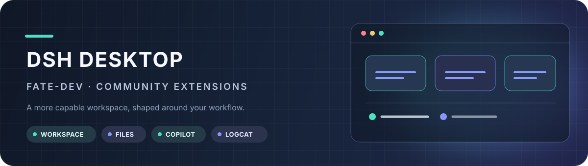
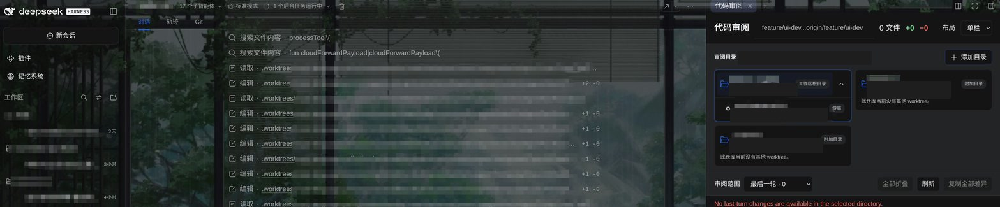

<h1 align="center">fate-dev DSH Desktop</h1>

基于 <a href="https://github.com/anywhere-labs/dsh-desktop">上游 DSH Desktop</a> 的社区扩展版本，面向代码工作区、文件审阅、Git 和 Android 调试场景。

## 导航

- [对原项目的改动](#对原项目的改动)
- [本地 Profile 插件](#本地-profile-插件)
- [本地配置](#本地配置)
- [下载链接](#下载链接)
- [代码改动记录 / Release Note](#代码改动记录--release-note)
- [安全与隐私](#安全与隐私)
- [效果图](#效果图)

## 对原项目的改动

每个功能一句话总结：

| 功能 | 一句话总结 |
| --- | --- |
| 多目录工作区 | 编辑工作区时可管理主目录和附加目录；文件浏览器可切换独立根目录，不改变会话工作目录，解除关联不会删除磁盘目录。 |
| 文件树快捷操作 | 从文件树直接定位系统文件管理器、用 VS Code 打开、复制路径，或把文件/目录作为结构化引用插入对话。 |
| Git Review（Git 代码审阅） | 按当前会话查看变更；可在主目录和附加目录根之间切换，并展开各根下的 Git 工作树（worktree）选择审阅范围。 |
| 可编辑 Git 工作区 | 在桌面端进行 Git 工作区相关操作，并将 Git 面板与代码审阅目录保持独立。 |
| GitHub Copilot | 使用 GitHub 设备码登录，并在模型选择器中使用可用的 Copilot 模型。 |
| Android Logcat | 通过 adb 选择设备，按进程、Tag、排除 Tag 或消息正则过滤实时日志，并支持暂停、复制、导出和设备截图。 |
| 目标续轮止血 | 自动续轮的目标连续几轮没有新证据、或同一调用反复出现时，先停续轮再让模型分析卡点，预算用尽才标记 blocked。 |
| Host 进程隔离 | Host Cordis 根跑在独立的 Electron Node-mode 子进程里，不走 Chromium 的 Utility 进程分配器；Host 意外退出不会重放在飞的任务。 |
| 会话与文件安全 | 文件引用使用结构化路径，README 与审阅截图不包含 Session、记忆数据库、凭据或访问令牌。 |

## 本地 Profile 插件

版本号取自本机 `desktop` Profile 的 manifest（`~/.dsh/profiles/desktop/package.json`），只列当前声明并启用的插件。

| 插件 | 版本 | 用途 |
| --- | ---: | --- |
| `dsh-byte-guard-recovery` | 0.1.0（仓库内 `file:` 插件） | 请求体字节超限（本地保险丝或端点 413）时原地修剪压缩并重试，不换会话 |
| `dsh-mnemon` | 0.5.30 | 可组合的分层记忆，附带 provider / strategy / source 子包 |
| `dsh-rewind-plugin` | 0.15.3 | 同窗口对话回退并还原工作区文件 |
| `dsh-session-recycle-bin` | 0.4.3 | 会话回收站：侧边栏删除图标、多选还原或彻底删除、活跃会话保护 |
| `dsh-dream-skin` | 10.10.0 | 界面换肤主题包 |
| `dsh-mermaid` | 0.4.1 | Mermaid 代码块按图 / 码切换渲染 |
| `dsh-ffmpeg` | 0.4.5 | 用自然语言调用 FFmpeg 处理已有音视频 |
| `@linxin666/dsh-client-ui-git-graph` | 0.4.6 | 新会话 Git 分支选择与提交图 |

Profile 的 bundle 顺序里还包含官方包 `@deepseek-ai/dsh-base`、`@deepseek-ai/dsh-web-app`、`@deepseek-ai/dsh-experimental-auto-review` 和 `dshmarket`。`dsh-byte-guard-recovery` 只在 Profile 目录以 `file:` 依赖存在，不进装机包。`dsh-rewind-plugin` 的快照文件名超长（ENAMETOOLONG，上游到 0.20.0 仍未限长）由 `config/desktop-profile/patches/dsh-rewind-plugin@0.15.3-name-cap.patch` 修在 Profile 安装副本上，升级插件后要重新套用，`scripts/rewind-snapshot-name-cap.test.mjs` 会拦住漏套的情况。

## 本地配置

配置快照在 [`config/desktop-profile/cordis.patch.yml`](config/desktop-profile/cordis.patch.yml)，只提交配置项本身，不含凭据值和本机路径。当前生效内容：

| 项 | 生效值 | 为什么这样配 |
| --- | --- | --- |
| 桌面外壳 | `mode: compatibility`、macOS 材质 `transparent`、Windows 材质 `off`、`networkExposure: loopback`、`openBrowser: true` | 兼容模式跑上游默认前端；只监听回环，不做局域网暴露 |
| 通知 | 回合完成/失败、任务完成/失败、定时任务完成/失败全部 `true` | 长任务离屏后靠通知回到会话 |
| 默认模型 | `github-copilot` / `gpt-6-sol` | 模型选择器的默认落点 |
| 权限预设 | 默认 `danger-full-access`（sandbox 全开、`approval: never`），另保留 `read-only` 与 `workspace-write` 两个 `ask` 预设 | 本机开发环境直接放开，预设仍可在设置里切换 |
| 请求体上限 | Copilot 单图 1 MiB、总请求 2 MiB | 与 `dsh-byte-guard-recovery` 的字节保险丝配套，超限先原地修剪 |
| 上下文压缩 | `compaction-basic`、`tool-result-pruner`、`command-compact` 全部显式 `disabled: false` | 上游 Web 载体默认关闭，且补丁是浅合并，必须显式打开；kimi-k3 按窗口 0.35 触发、保留 0.08，先于 2 MiB 字节保险丝 |
| 记忆 | `dsh-mnemon` 远程访问 `read-only`、本地 embedding 关闭、`strict-v1` 召回策略、三层记忆视图 | 不额外拉本地向量服务 |
| 界面 | 主题跟随系统、字号 17、开发者工具开启、过程与用量视图 `detailed` | 排查需要完整过程与用量 |
| 会话日志 | `@deepseek-ai/dsh-session-log-deepseek` `enabled: false` | 不把会话内容写日志 |

两点注意：

- API Key 只以环境变量名引用（例如 `XIAOMI_TOKEN_PLAN_CN_API_KEY`），仓库不落任何密钥值。
- 本机 Profile 里还残留 `@zhangfengshun/dsh-remote-ssh` 的配置项，但该插件已不在 manifest 中，启动时会打印 entry not found 警告；仓库快照不收录这一段，因为它包含内网地址和私钥路径。

## 下载链接

当前 Release 只保留 Stable 通道：

| 版本 | Debian / Ubuntu |
| --- | --- |
| Stable 2.0.17 | [下载 `.deb`](https://github.com/FateFeng/dsh-desktop/releases/download/v2.0.17-fate-dev/DSH-Desktop-2.0.17-amd64.deb) |

本项目后续不再分发 AppImage，仅维护可验证的 Debian / Ubuntu Stable 安装包。

- Release 页面：<https://github.com/FateFeng/dsh-desktop/releases/tag/v2.0.17-fate-dev>
- Debian SHA-256：`2915f6ed9be7beddf42159c9553f1d1473f99b06982e663fa3236356f2a28479`
- 当前已验证 `.deb` 资产大小：242,430,032 bytes。

`2.0.18` 只在 `fate-dev` 分支本地出包，未发布到 Release：

| 版本 | 本机产物 | 状态 |
| --- | --- | --- |
| 2.0.18 | `dsh-plugin-desktop/dist/DSH-Desktop-2.0.18-amd64.deb`（363,598,336 bytes，SHA-256 `d40534c09bc75b6360502beb0f5580249b6c091049f1015ec3f9852974036b35`） | 由 `./scripts/build-ubuntu.sh` 生成；子模块当时检出在本地系列分支上，包内带本机运行时覆盖层，只用于本机验证 |

## 代码改动记录 / Release Note

### 三通道统一到 0.2.2-rc.1（2026-11-06）

- `upstream.json` 的 stable / beta / next 现在记录同一个上游提交 `66491b05e3`（tag `dsh-v0.2.2-rc.1`），`sourceVersion` 与 `runtimePackageVersion` 都是 `0.2.2-rc.1`，`runtimeSource` 都指向 `vendor/dsh-runtime/0.2.2-rc.1/manifest.json`；`activeChannel` 仍是 `beta`。上一节里「Stable 留在 alpha.2」的取舍到此结束。
- 依赖图随之收敛：根 `package.json` 的 `resolutions` 从 1504 条减到 764 条，`patches/` 从 102 个 `.patch` 减到 47 个（36 个 `@0.2.2-rc.1` 运行时补丁 + 11 个第三方补丁），`0.2.2-alpha.2` 那 31 个和 `0.2.1-rc.3` 那批一起删；`dsh-community-market` 的 peer 从三值兼容串收成单一 `0.2.2-rc.1`（Cordis 侧仍写 `4.0.5 || 4.0.6-alpha.1 || 4.1.0`，实际解析到 `4.1.0`）。`yarn.lock` 重生成，`node scripts/sync-vendored-runtime.mjs --check` 三条通道全绿。
- 上一节报的唯一红灯（`tests/host-process-integration.spec.ts` 的「AA enabled: true」）在 rc.1 上过了：Agents Anywhere 桥的 peer 串覆盖 Stable 用的运行时。`corepack yarn workspace dsh-plugin-desktop test` 现在 2103 条 0 红（2091 通过、12 跳过）。
- `dsh-plugin-desktop` 自身 typecheck 在 `sidebar.workspaces.workspace.edit` 上的红灯也随本地系列进 rc.1 消失——该 slot 由本地 harness 系列声明，运行时带上它之后测试固定装置才有类型可读。
- Settings 侧栏图标不再靠打补丁。rc.1 的 settings shell 开放了 `settings.section.icon` 槽（`packages/client/ui-settings/src/client/contract/slots.ts`，按 `settings.section` 的 id 寻址），Desktop 图标改成注册进这个槽：[`dsh-plugin-desktop/src/client/DesktopSettingsIcon.tsx`](dsh-plugin-desktop/src/client/DesktopSettingsIcon.tsx)，由 `src/client/desktop-settings.ts` 在 section 注册之后调用。`patches/dsh-client-ui-settings-general@0.2.2-alpha.2.patch` 因此不再重记，`tests/package.spec.ts` 改成断言这个包保持未打补丁。
- Cordis 4.1.0 把 `internal/config` 的 fiber 改成第一个入参（`@deepseek-ai/cordis/lib/types/events.d.ts:229` 声明 `'internal/config'(fiber: Fiber, next: () => any)`），所以 [`dsh-plugin-desktop/src/settings-bridge.ts:264`](dsh-plugin-desktop/src/settings-bridge.ts) 的组合校验读这个入参而不再是 `this`。两个 Workspace 测试的固定装置补上新增的会话级标准 props（`useContextMenu`、`useAccess`、`useConversation`、`useInput`、`inputActions`）。rc.1 的 sidebar 根组件多了 `drawer` 这个抽屉模式（`@deepseek-ai/dsh-client-ui-sidebar/lib/client.js` 用它决定是否常驻），`src/client/AdvancedFrame.tsx` 的自有外壳因此显式传 `drawer: false`。
- `scripts/prepare-local-runtime.mjs`：`restorePinnedPackage` 先看该通道是否还装这个包，没装就直接返回。上游在 `0.2.1-rc.2` 删了 `@deepseek-ai/dsh-client-ui-deepseek-model-label-1017`，但覆盖层缓存里的旧名字还在；按原顺序会先要求 vendor manifest 有这条记录，然后报 `pinned runtime manifest has no ...`。
- 本地 harness 系列在 rc.1 上的重放存档为 `patches/upstream/0.2.2-rc.1/worktree-snapshot-20261106.patch`（116 个文件、+2793/−188，等于 `git diff 66491b05e3..013e5314e0`）；哪些本地改动被上游吸收、哪些是 rc.1 API 漂移逼出来的决定，记在 [`patches/upstream/README.md`](patches/upstream/README.md)。子模块记录的 pin 仍是官方 `66491b05e3`，本机工作区检出在本地分支 `local-series-0.2.2-rc.1` 上，所以 `./scripts/build-ubuntu.sh` 会打「local upstream overlay」警告——这类包只用于本机验证，不能作为发布包。
- 门禁状态：`corepack yarn install --immutable`、`yarn typecheck`、`check:desktop-variants`（Next ↔ Beta 按 359 个文件对齐）、`check:bilingual-docs` 与 `dsh-plugin-desktop` 的 `build` / `typecheck` / `test` 全绿；子模块 `pnpm run verify-translation-pairing` 的 5 条过期配对记录用 `--write` 重记后 1164 对全部一致。`check:layout` 仍在 `stable desktop dependencies.dsh-ide-git bypasses the published DSH package boundary` 上报红，`corepack yarn aa:check` 仍报记录的 AA 产物不是最新 AA `main`（当前 `8183fb563c`）；这两条与本次拉齐无关，也都不在 CI 的打包门禁里。
- 装机包变大不是本机覆盖层造成的：上游这代给 linux 目标也加了 `extraResources`（`.desktop-build/runtime` → `resources/runtime`，`dsh-plugin-desktop/package.json` 的 `build.linux`），2.0.18 的 `.deb` 因此多带 `resources/runtime/x64`（399,765,281 bytes、7981 个条目），2.0.17 的包里这一目录是 0；两版共 34,771 → 45,161 个条目。

### 与上游原仓库拉齐（2026-11-05）

以下是当时的状态，涉及 Stable 运行时、AA 红灯和门禁的条目已被上一节「三通道统一到 0.2.2-rc.1」取代，保留是为了记录当时为什么这样选。

- 本地 `master` 先与 <https://github.com/anywhere-labs/dsh-desktop> 同步，再合入 `fate-dev`，带入 48 个上游提交：Beta 与 Next 一起升到 DeepSeek Harness `0.2.2-rc.1`，子模块 pin 取 `66491b05e3`（与 `upstream.json` 的 activeChannel 一致），`vendor/dsh-runtime/0.2.2-rc.1/`、`patches/` 下的 `@0.2.2-rc.1` 补丁与 Next 的打包脚本随之更新，`_deprecated/` 里的旧 runtime 快照和旧补丁清理掉。
- 通道取值的取舍：Stable 继续留在 `0.2.2-alpha.2`（本机 2.0.17 装机包和 71 个本地 Stable 源码文件都按这条运行时验证过），Beta/Next 接受上游的 `0.2.2-rc.1`。因此根 `package.json` 的 `resolutions` 同时保留 alpha.2 与 rc.1 两套 vendor 映射，`dsh-ide-git`、`@earendil-works/pi-ai` 的本地补丁映射不变；`0.2.1-rc.5` 和 `0.2.1-rc.3` 两套随 Next 升级删除（688 条 rc.3 selector），`yarn.lock` 随之重生成——`dsh-plugin-desktop/tests/package.spec.ts` 要求每条 `@deepseek-ai/dsh*` selector 都属于某个通道记录的 `sourceVersion`，留着没通道引用的族就直接报错。（本节的两套 vendor 映射已被上一节收成单一 `0.2.2-rc.1`。）
- Stable 留在 alpha.2 的代价（已被上一节取代：Stable 现在也在 `0.2.2-rc.1`，AA 这一行不再被禁用）：上游带来的 Agents Anywhere 桥 `@agents-anywhere/dsh-bridge-next@2.1.0-desktop.cc1883dad3ff4.r5dbd817f` 只接受 peer `0.2.1-rc.3 || 0.2.2-rc.1`，alpha.2 运行时的插件兼容门禁会禁用这一行，所以 `tests/host-process-integration.spec.ts` 的「AA enabled: true」在本分支红。合并前的本地桥（`r156e8f86`，peer `0.2.0-rc.2`）同样落在 alpha.2 之外，这条不是新引入的回归；要让 Stable 的 AA 可用，只能把 stable 通道也推到 `0.2.2-rc.1` 并重出包。
- `dsh-community-market` 的 peer 兼容串扩成 `0.2.1-rc.3 || 0.2.2-alpha.2 || 0.2.2-rc.1`（Cordis `4.0.5 || 4.0.6-alpha.1 || 4.1.0`），`tests/contracts.spec.ts` 的期望同步；该包仍是文档脚手架，不声明可载入入口。
- Beta 和 Next 现在跟同一条上游发布，必须完全镜像：`dsh-desktop-next/tsconfig.json` 里那段 `paths` 去掉 `next-lead` 标记并同步到 `dsh-plugin-desktop-beta/tsconfig.json`，`corepack yarn check:desktop-variants` 按 359 个文件对齐通过。
- 上游删掉了 `0.2.2-alpha.2` 那批运行时补丁，但 Stable 仍然依赖，已把 31 个 `patches/*@0.2.2-alpha.2.patch` 恢复到工作树（已被上一节取代：Stable 到 rc.1 后这批又全删了）。
- `dsh-plugin-desktop/tests/package.spec.ts` 的 pi-ai / pi-telemetry 断言按合并后的依赖图改：pi-ai 只剩两条 npm 解析——`0.87.1`（Desktop 自己的 Copilot 目录 pin）与打了 `patches/pi-ai@1.4.0.patch` 的 `1.4.0`（运行时）；`pi-telemetry@npm:^1.1.0` 这条根 guard 的唯一请求方随 rc.5 族消失，条目按上游保留，lock 里只剩各 pi-ai 自带的 `0.87.1` 和 `1.4.0`。
- Host 与 supervisor 的 RPC 换了传输：上游把 `src/host-process-entry.ts` 从 `process.send` 改成 `process.parentPort`，而 `process.parentPort` 只有 Electron 的 `utilityProcess.fork`（`src/host-process.ts:49`）才提供，`child_process.fork` + `ELECTRON_RUN_AS_NODE` 里它是 `undefined`。两个本地测试按新契约重写：`host-process-node-mode.spec.ts` 现在断言非 utility 进程必须拒绝启动，`workspace-sources-root-switch.spec.tsx` 断言 Files 树只切自己的根、不再回调移动会话 cwd。
- `dsh-plugin-desktop/lib/` 是按合并前的本地 runtime 覆盖层编出来的，`yarn install` 换成已发布包后 `lib/profile-manager-*.js` 会引用 alpha.2 不导出的 `PROFILE_TEMPLATES`；已用 `tsdown` + 两个 `vite build` 重编，并给 `DesktopWebServer.Config` 加了显式类型标注（Stable 树里 alpha.2 的 `dsh-llm` 自带一份 schemastery，继承来的 `Schema<Config>` 无法在 `.d.ts` 里命名）。
- 上游 README 的徽章、下载表和插件生态章节没有并入：本文件的社区版内容（功能表、本地 Profile 插件、本地配置、本地改动记录、唯一一张效果图）继续以 `fate-dev` 为准。
- 门禁状态：`corepack yarn install --immutable`、`yarn typecheck`（Beta / Market / Next）、`check:desktop-variants`、`check:bilingual-docs` 全绿；`corepack yarn workspace dsh-plugin-desktop test` 2102 条里只剩「AA enabled: true」这一条红（上一条），根 `yarn test` 因此一起红。`dsh-plugin-desktop` 自身的 typecheck 仍在 `sidebar.workspaces.workspace.edit` 上报红——该 slot 只存在于未发布的 harness 源码，两个已发布运行时都不带；`check:layout` 仍在 `dsh-plugin-desktop` 依赖 `dsh-ide-git: workspace:*` 上报红；`corepack yarn aa:check` 报记录的 AA 产物（`cc1883dad3ff4`）落后于 AA `main`（`296f70ed4036`），发版前要重跑 `aa:prepare-release`。前两条合并前就已如此，且这几条都不在 CI 的打包门禁里。（本节的 AA 红灯、`sidebar.workspaces.workspace.edit` typecheck 红灯和 2102 条计数已被上一节取代。）

### 与云端 0.2.2-alpha.2 线合并（`ce00e94318`，2026-11-05）

- 运行时升到 `0.2.2-alpha.2`，上游补丁序列按云端版本重做，`patches/` 下的 `patch:` 文件与 `yarn.lock` 一起对齐。
- Beta 通道迁到 dsh-desktop-next 框架：`dsh-plugin-desktop-beta` 的 61 个旧结构文件删除，内容都在 `dsh-plugin-desktop` 或合并前快照 `cb23a018b0` 里，`corepack yarn check:desktop-variants` 现在按 Next ↔ Beta 比对。
- 云端已有的实现一律以云端为准，包括 Git Review 多根、附加目录、目标续轮止血、Host 进程隔离和渲染崩溃诊断。

### 本地相对云端的独有改动（2026-11-05）

| 改动 | 位置 | 说明 |
| --- | --- | --- |
| 多 worktree 仓库扫描 | [`dsh-ide-git/src/index.js:1501`](dsh-ide-git/src/index.js) | 仓库枚举默认跳过所有点目录，这里放行 `.worktrees`，Git 面板与代码审阅才能发现并列的 worktree；配套测试在 `dsh-ide-git/tests/repos.test.mjs` |
| 字节保险丝恢复插件 | [`config/desktop-profile/plugins/dsh-byte-guard-recovery/`](config/desktop-profile/plugins/dsh-byte-guard-recovery/) | 请求体超限时原地修剪压缩并重试，含恢复阶梯、压缩不变量、真实 surface 折叠三个测试 |
| Crashpad minidump 取证 | [`dsh-plugin-desktop/src/crashpad-evidence.ts`](dsh-plugin-desktop/src/crashpad-evidence.ts) | 解析本地 minidump 头部，诊断导出只列元信息，dump 本体不出机器；`src/main.ts` 在子进程 crashed/oom/launch-failed 和上次运行没收尾时打印一行 dump 摘要（异常码、模块、偏移、pid），`host.exited` 生命周期事件也带上 Host 的 pid，用来对上 Crashpad 记录的那一份 |
| Host 入口与 Files 根切换测试 | `dsh-plugin-desktop/tests/host-process-node-mode.spec.ts`、`dsh-plugin-desktop/tests/workspace-sources-root-switch.spec.tsx` | 按上游的新传输契约重写：一个断言非 Electron `utilityProcess` 启动必须拒绝并带回 supervisor 报错，一个断言 Files 树只切自己的根、`selectRoot` 收到的是空操作回调而不移动会话 cwd |
| 上游本地补丁序列存档 | [`patches/upstream/`](patches/upstream/) | rc.2 的 0014（会话持久化不读更新 harness 的数据）、0015（草稿只从可用 seed 恢复），以及 rc.2 / rc.5 / rc.1 三份重放快照；rc.1 那份是 `0.2.2-rc.1/worktree-snapshot-20261106.patch` |
| Profile 配置快照 | [`config/desktop-profile/cordis.patch.yml`](config/desktop-profile/cordis.patch.yml) | 见「本地配置」一节 |
| 布局门禁补第 6 个 workspace | [`scripts/verify-layout.mjs:33`](scripts/verify-layout.mjs) | 根 `workspaces` 已含 `dsh-ide-git`，检查列表漏了这一项 |
| electron-builder 启动器改为可选 | [`dsh-plugin-desktop/scripts/package-linux.ts:63`](dsh-plugin-desktop/scripts/package-linux.ts) | 本地 argv 归一化启动器缺省时直接调用 electron-builder CLI，上游新增的 `package-targets.spec.ts` 固定装置不提供该字段也能通过 |

### 2.0.17-fate-dev

- Workspace Edit 可新增或解除附加目录关联，Files 浏览器按主目录/附加目录独立切换；Git Review 根目录树按 Workspace source 展开 Git 工作树（worktree），切换审阅根或工作树时保留当前会话范围，枚举失败可重试。
- `5fced936e9`：将 Git Review worktree 合并到 `fate-dev`。
- `f7c3d06b81`：新增按会话隔离的 Git Review，并支持附加工作区根。
- `97291e91c9`：接入可编辑 Git 工作区工具。
- `70962df847`：修复在光标位置插入文件引用。
- `91efd87d8d`：要求 Assistant 输出绝对文件路径。
- `6458eff142`：保存 workspace sources，并整合 Desktop workspace 功能。
- `7300dd918c`：新增文件树上下文菜单快捷操作。
- `de3b76afbc`：加入 GitHub Copilot provider 支持与 Android Logcat 过滤记忆。
- `b125d0203d`：更新 Desktop 版本至 `2.0.17`。
- `9765a12e67`：补充 README、Git Review 效果图、插件清单与 Stable 下载说明。

## 安全与隐私

- README 只保留一张效果图，截图内的本地路径、仓库名和目录细节均已遮盖。
- 文档只记录插件包名、版本和配置项名称，不记录本机目录、内网地址、账号、Session 内容或插件配置值。
- `config/desktop-profile/cordis.patch.yml` 只收录配置项；凭据一律用环境变量名引用，含私钥路径与内网地址的片段不入库。
- 发布前应继续检查新增截图和构建产物，避免把本地 Session、记忆数据库、凭据或访问令牌放入仓库或 Release。

## 效果图

### 附加目录与 Git Review 工作树选择

插件自身的界面截图仍在 <a href="dsh-plugin-desktop/docs/screenshots/">dsh-plugin-desktop/docs/screenshots/</a>。

