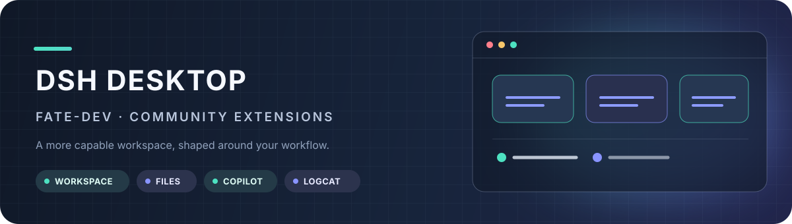
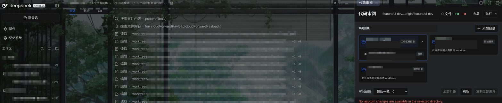

<h1 align="center">fate-dev DSH Desktop</h1>

基于 <a href="https://github.com/anywhere-labs/dsh-desktop">上游 DSH Desktop</a> 的社区扩展版本，面向代码工作区、文件审阅、Git 和 Android 调试场景。

## 导航

- [对原项目的改动](#对原项目的改动)
- [本地 Profile 插件](#本地-profile-插件)
- [本地配置](#本地配置)
- [下载链接](#下载链接)
- [代码改动记录 / Release Note](#代码改动记录--release-note)
- [安全与隐私](#安全与隐私)
- [效果图](#效果图)

## 对原项目的改动

每个功能一句话总结：

| 功能 | 一句话总结 |
| --- | --- |
| 多目录工作区 | 编辑工作区时可管理主目录和附加目录；文件浏览器可切换独立根目录，不改变会话工作目录，解除关联不会删除磁盘目录。 |
| 文件树快捷操作 | 从文件树直接定位系统文件管理器、用 VS Code 打开、复制路径，或把文件/目录作为结构化引用插入对话。 |
| Git Review（Git 代码审阅） | 按当前会话查看变更；可在主目录和附加目录根之间切换，并展开各根下的 Git 工作树（worktree）选择审阅范围。 |
| 可编辑 Git 工作区 | 在桌面端进行 Git 工作区相关操作，并将 Git 面板与代码审阅目录保持独立。 |
| GitHub Copilot | 使用 GitHub 设备码登录，并在模型选择器中使用可用的 Copilot 模型。 |
| Android Logcat | 通过 adb 选择设备，按进程、Tag、排除 Tag 或消息正则过滤实时日志，并支持暂停、复制、导出和设备截图。 |
| 目标续轮止血 | 自动续轮的目标连续几轮没有新证据、或同一调用反复出现时，先停续轮再让模型分析卡点，预算用尽才标记 blocked。 |
| Host 进程隔离 | Host Cordis 根跑在独立的 Electron Node-mode 子进程里，不走 Chromium 的 Utility 进程分配器；Host 意外退出不会重放在飞的任务。 |
| 会话与文件安全 | 文件引用使用结构化路径，README 与审阅截图不包含 Session、记忆数据库、凭据或访问令牌。 |

## 本地 Profile 插件

版本号取自本机 `desktop` Profile 的 manifest（`~/.dsh/profiles/desktop/package.json`），只列当前声明并启用的插件。

| 插件 | 版本 | 用途 |
| --- | ---: | --- |
| `dsh-byte-guard-recovery` | 0.1.0（仓库内 `file:` 插件） | 请求体字节超限（本地保险丝或端点 413）时原地修剪压缩并重试，不换会话 |
| `dsh-mnemon` | 0.5.30 | 可组合的分层记忆，附带 provider / strategy / source 子包 |
| `dsh-rewind-plugin` | 0.15.3 | 同窗口对话回退并还原工作区文件 |
| `dsh-session-recycle-bin` | 0.4.3 | 会话回收站：侧边栏删除图标、多选还原或彻底删除、活跃会话保护 |
| `dsh-dream-skin` | 10.10.0 | 界面换肤主题包 |
| `dsh-mermaid` | 0.4.1 | Mermaid 代码块按图 / 码切换渲染 |
| `dsh-ffmpeg` | 0.4.5 | 用自然语言调用 FFmpeg 处理已有音视频 |
| `@linxin666/dsh-client-ui-git-graph` | 0.4.6 | 新会话 Git 分支选择与提交图 |

Profile 的 bundle 顺序里还包含官方包 `@deepseek-ai/dsh-base`、`@deepseek-ai/dsh-web-app`、`@deepseek-ai/dsh-experimental-auto-review` 和 `dshmarket`。`dsh-byte-guard-recovery` 只在 Profile 目录以 `file:` 依赖存在，不进装机包。

## 本地配置

配置快照在 [`config/desktop-profile/cordis.patch.yml`](config/desktop-profile/cordis.patch.yml)，只提交配置项本身，不含凭据值和本机路径。当前生效内容：

| 项 | 生效值 | 为什么这样配 |
| --- | --- | --- |
| 桌面外壳 | `mode: compatibility`、macOS 材质 `transparent`、Windows 材质 `off`、`networkExposure: loopback`、`openBrowser: true` | 兼容模式跑上游默认前端；只监听回环，不做局域网暴露 |
| 通知 | 回合完成/失败、任务完成/失败、定时任务完成/失败全部 `true` | 长任务离屏后靠通知回到会话 |
| 默认模型 | `github-copilot` / `gpt-6-sol` | 模型选择器的默认落点 |
| 权限预设 | 默认 `danger-full-access`（sandbox 全开、`approval: never`），另保留 `read-only` 与 `workspace-write` 两个 `ask` 预设 | 本机开发环境直接放开，预设仍可在设置里切换 |
| 请求体上限 | Copilot 单图 1 MiB、总请求 2 MiB | 与 `dsh-byte-guard-recovery` 的字节保险丝配套，超限先原地修剪 |
| 上下文压缩 | `compaction-basic`、`tool-result-pruner`、`command-compact` 全部显式 `disabled: false` | 上游 Web 载体默认关闭，且补丁是浅合并，必须显式打开；kimi-k3 按窗口 0.35 触发、保留 0.08，先于 2 MiB 字节保险丝 |
| 记忆 | `dsh-mnemon` 远程访问 `read-only`、本地 embedding 关闭、`strict-v1` 召回策略、三层记忆视图 | 不额外拉本地向量服务 |
| 界面 | 主题跟随系统、字号 17、开发者工具开启、过程与用量视图 `detailed` | 排查需要完整过程与用量 |
| 会话日志 | `@deepseek-ai/dsh-session-log-deepseek` `enabled: false` | 不把会话内容写日志 |

两点注意：

- API Key 只以环境变量名引用（例如 `XIAOMI_TOKEN_PLAN_CN_API_KEY`），仓库不落任何密钥值。
- 本机 Profile 里还残留 `@zhangfengshun/dsh-remote-ssh` 的配置项，但该插件已不在 manifest 中，启动时会打印 entry not found 警告；仓库快照不收录这一段，因为它包含内网地址和私钥路径。

## 下载链接

当前 Release 只保留 Stable 通道：

| 版本 | Debian / Ubuntu |
| --- | --- |
| Stable 2.0.17 | [下载 `.deb`](https://github.com/FateFeng/dsh-desktop/releases/download/v2.0.17-fate-dev/DSH-Desktop-2.0.17-amd64.deb) |

本项目后续不再分发 AppImage，仅维护可验证的 Debian / Ubuntu Stable 安装包。

- Release 页面：<https://github.com/FateFeng/dsh-desktop/releases/tag/v2.0.17-fate-dev>
- Debian SHA-256：`2915f6ed9be7beddf42159c9553f1d1473f99b06982e663fa3236356f2a28479`
- 当前已验证 `.deb` 资产大小：242,430,032 bytes。

## 代码改动记录 / Release Note

### 与云端 0.2.2-alpha.2 线合并（`ce00e94318`，2026-11-05）

- 运行时升到 `0.2.2-alpha.2`，上游补丁序列按云端版本重做，`patches/` 下的 `patch:` 文件与 `yarn.lock` 一起对齐。
- Beta 通道迁到 dsh-desktop-next 框架：`dsh-plugin-desktop-beta` 的 61 个旧结构文件删除，内容都在 `dsh-plugin-desktop` 或合并前快照 `cb23a018b0` 里，`corepack yarn check:desktop-variants` 现在按 Next ↔ Beta 比对。
- 云端已有的实现一律以云端为准，包括 Git Review 多根、附加目录、目标续轮止血、Host 进程隔离和渲染崩溃诊断。

### 本地相对云端的独有改动（2026-11-05）

| 改动 | 位置 | 说明 |
| --- | --- | --- |
| 多 worktree 仓库扫描 | [`dsh-ide-git/src/index.js:1501`](dsh-ide-git/src/index.js) | 仓库枚举默认跳过所有点目录，这里放行 `.worktrees`，Git 面板与代码审阅才能发现并列的 worktree；配套测试在 `dsh-ide-git/tests/repos.test.mjs` |
| 字节保险丝恢复插件 | [`config/desktop-profile/plugins/dsh-byte-guard-recovery/`](config/desktop-profile/plugins/dsh-byte-guard-recovery/) | 请求体超限时原地修剪压缩并重试，含恢复阶梯、压缩不变量、真实 surface 折叠三个测试 |
| Crashpad minidump 取证 | [`dsh-plugin-desktop/src/crashpad-evidence.ts`](dsh-plugin-desktop/src/crashpad-evidence.ts) | 解析本地 minidump 头部，诊断导出只列元信息，dump 本体不出机器 |
| Node-mode Host 与附加根切换测试 | `dsh-plugin-desktop/tests/host-process-node-mode.spec.ts`、`dsh-plugin-desktop/tests/workspace-sources-root-switch.spec.tsx` | 覆盖 Host 独立子进程的 RPC，以及 Files 树切到附加根后按会话 cwd 记选择 |
| 上游本地补丁序列存档 | [`patches/upstream/`](patches/upstream/) | rc.2 的 0014（会话持久化不读更新 harness 的数据）、0015（草稿只从可用 seed 恢复），以及 rc.2 / rc.5 两份工作区快照 |
| Profile 配置快照 | [`config/desktop-profile/cordis.patch.yml`](config/desktop-profile/cordis.patch.yml) | 见「本地配置」一节 |
| 布局门禁补第 6 个 workspace | [`scripts/verify-layout.mjs:33`](scripts/verify-layout.mjs) | 根 `workspaces` 已含 `dsh-ide-git`，检查列表漏了这一项 |

### 2.0.17-fate-dev

- Workspace Edit 可新增或解除附加目录关联，Files 浏览器按主目录/附加目录独立切换；Git Review 根目录树按 Workspace source 展开 Git 工作树（worktree），切换审阅根或工作树时保留当前会话范围，枚举失败可重试。
- `5fced936e9`：将 Git Review worktree 合并到 `fate-dev`。
- `f7c3d06b81`：新增按会话隔离的 Git Review，并支持附加工作区根。
- `97291e91c9`：接入可编辑 Git 工作区工具。
- `70962df847`：修复在光标位置插入文件引用。
- `91efd87d8d`：要求 Assistant 输出绝对文件路径。
- `6458eff142`：保存 workspace sources，并整合 Desktop workspace 功能。
- `7300dd918c`：新增文件树上下文菜单快捷操作。
- `de3b76afbc`：加入 GitHub Copilot provider 支持与 Android Logcat 过滤记忆。
- `b125d0203d`：更新 Desktop 版本至 `2.0.17`。
- `9765a12e67`：补充 README、Git Review 效果图、插件清单与 Stable 下载说明。

## 安全与隐私

- README 只保留一张效果图，截图内的本地路径、仓库名和目录细节均已遮盖。
- 文档只记录插件包名、版本和配置项名称，不记录本机目录、内网地址、账号、Session 内容或插件配置值。
- `config/desktop-profile/cordis.patch.yml` 只收录配置项；凭据一律用环境变量名引用，含私钥路径与内网地址的片段不入库。
- 发布前应继续检查新增截图和构建产物，避免把本地 Session、记忆数据库、凭据或访问令牌放入仓库或 Release。

## 效果图

### 附加目录与 Git Review 工作树选择

插件自身的界面截图仍在 <a href="dsh-plugin-desktop/docs/screenshots/">dsh-plugin-desktop/docs/screenshots/</a>。

