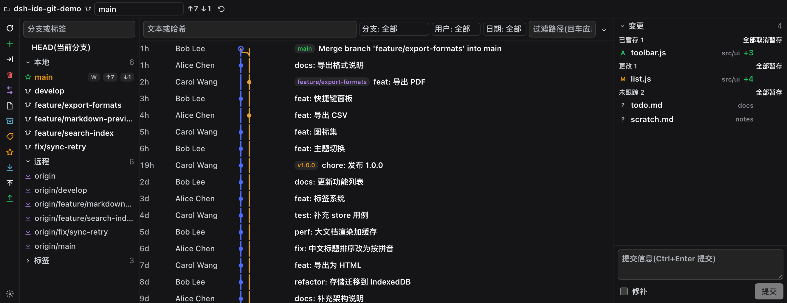
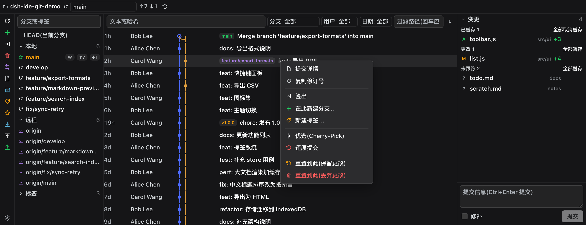
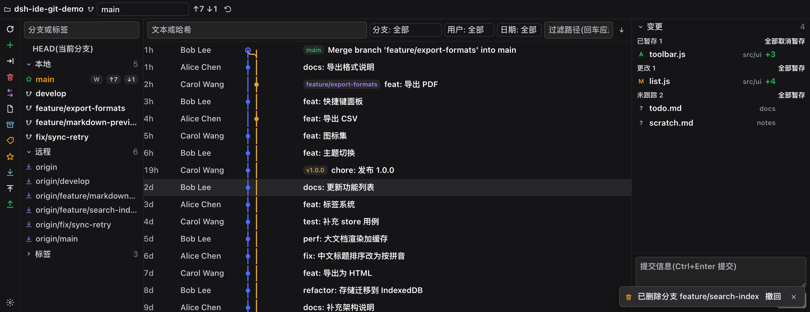
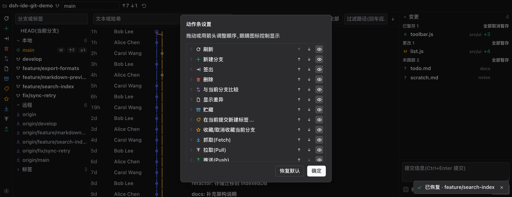
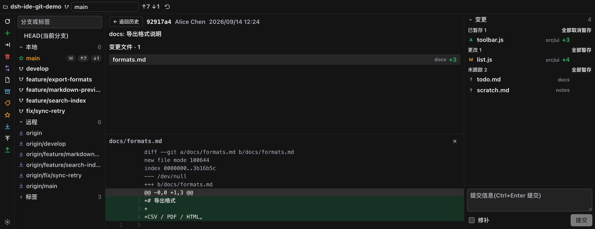
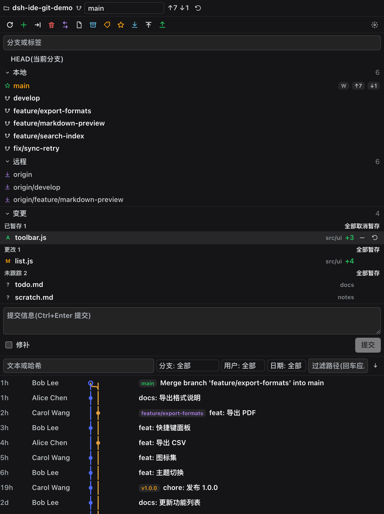

# dsh-ide-git

[](https://awesome-dsh-plugin.com)

[简体中文](README.md) | English

> An **IDE-grade Git tool window** for the [DeepSeek Harness (DSH)](https://github.com/deepseek-ai/deepseek-harness) sidebar — branch tree on the left, commit graph in the middle, changes and commit details on the right, with JetBrains-style actions. Registered as a native [dsh-better-sidebar](https://github.com/omdsh-dev/DSH-better-sidebar) tab, usable in both the native right sidebar and the bottom workbench; since v0.13.0 also as a **conversation-area tab** (a Git tab beside Chat/Trajectory, switchable off in settings).

DSH's built-in Git panel covers stage / commit / revert / history. `dsh-ide-git` adds the layer IDE users expect: a **branch tree with a full context menu**, a **commit graph**, **commit details with per-file diffs**, a **grouped changes list** and a commit box.

### Multi-root workspaces in DSH Desktop Stable

In DSH Desktop Stable on Linux/macOS, the Git panel can independently select the current Workspace's **primary root or an attached directory**, then select a Git repository within that directory. This affects only the Git panel: it does not change the Files view's selection, Session working directory, or Workspace identity. Switching directories clears the old repository's action context. Desktop Host supplies the live directory list; detached or inaccessible directories lose Git authorization. Windows currently offers only the primary root, consistent with Desktop's attached-directory safety policy. Standalone DSH installations without the multi-root service retain the original single-workspace experience.

## Screenshots

> Captured from a **clean DSH with only two plugins installed** (`dsh-better-sidebar` + this one), bound to a fictional demo repository (`scripts/demo-repo.mjs`). No real workspace, no wallpaper plugin and no other panel is in frame; the whole sequence is reproducible with `scripts/screenshots.mjs`.

<table>
<tr>
<td align="center" width="58%"></td>
<td valign="top"><b>Bottom workbench (wide → three panes)</b><br/>A JetBrains-style action rail whose button count follows the rail's <b>own height</b> (overflow folds into <code>⋯</code>, and <code>⚙</code> at the end reorders or hides actions), a commit list in IDEA column order (<b>date → author → graph → refs → subject</b>) with the filter row above it (text/hash, branch or tag, author, date, path), and the changes pane with the commit box.</td>
</tr>
</table>

<table>
<tr>
<td align="center" width="58%"></td>
<td valign="top"><b>Commit context menu</b><br/>Details, copy revision, checkout, new branch here, new tag, cherry-pick, revert, reset here (keep / discard) — destructive rows in red, positioned inside the panel so it opens in the bottom workbench too.</td>
</tr>
<tr>
<td align="center" width="58%"></td>
<td valign="top"><b>Deletes are reversible</b><br/>Deleting a branch or a stash is a <b>real delete</b>, but the host records the object id first: the toast in the corner offers <b>Undo</b> (one-shot, valid 30 minutes), and the toolbar keeps a “recently deleted” menu for when the toast is gone. Deleting <code>main</code>/<code>master</code> asks you to type the branch name.</td>
</tr>
</table>

<table>
<tr>
<td align="center" width="58%"></td>
<td valign="top"><b>Configurable action rail</b><br/>Drag or use the arrows to reorder, the eye to hide an action. Only the permutation and the hidden set are stored (normalised), so a later version that adds an action never breaks an existing config.</td>
</tr>
<tr>
<td align="center" width="58%"></td>
<td valign="top"><b>Commit details</b><br/>Full message, author and date, changed files with +/− counts, and a line-level diff with gutters, hunk highlighting and red/green backgrounds.</td>
</tr>
</table>

<table>
<tr>
<td align="center" width="58%"></td>
<td valign="top"><b>One registration, two layouts</b><br/>In the narrow, tall <b>native right sidebar</b> the same panel stacks: rail as a single row on top, changes first, history below. The panel only measures itself — it never guesses which container it is in.</td>
</tr>
</table>

## Send to chat

Everything in the panel can be right-clicked into the **current session's composer** — through DSH's official insertion channel (it appends at the tail without touching what you already typed; while sending, or when the service is absent, it falls back to copying the payload with a toast, never a dead click):

- **Commit** → `git commit 47ad017 "Subject" (repo xxx)`: short hash + message + repository, one sentence naming a revision;
- **Branch** → `git branch main (repo xxx)`;
- **File** (change rows and commit-detail file rows) → a `@path` file reference chip (DSH's native @ grammar, quoted paths included) or just the raw path;
- **Selected diff lines**: select some text in a diff window (opened from a commit detail or the working tree), right-click → **Send selected lines to chat**: an `@file` chip plus a line note — `lines N–M (commit 47ad017 "Subject" @ branch)` for a commit, `lines N–M (worktree, staged / uncommitted)` for the working tree. Numbers are reconstructed from the diff rows under the selection against the patch's hunk headers, in **new-file numbering**; a purely deleted span reports OLD numbers and says so. If the selection cannot be pinned to diff rows the menu degrades to **Send selected snippet to chat** (text truncated at 600 characters) instead of inventing numbers, and a **Copy the selection reference** item is always there. With no selection the browser's own menu stays.

Also in place: change-row and detail-file-row icons are tinted by extension (DSH's own FileTypeIcon); diff previews render through DSH's own DiffBlock (red/green rows, copy / wrap toolbar, host-consistent visuals); the diff window's height is draggable and remembered per placement; and the whole panel can live in the **main conversation area** — the Git tab next to Dialogue / Trace, switchable in the plugin settings.

## Where it mounts: two hosts, one panel

The plugin registers once; which surface it lands on is the **host's** decision, and the two doors are exclusive:

| Host | When | What you get |
|---|---|---|
| **dsh-better-sidebar** (optional) | whenever it is installed | its tab system: the tab in the right sidebar **plus the bottom workbench**; the plugin also shows up as a card in its settings page |
| **DSH's own right sidebar** | automatically, when better-sidebar is absent | a **Git** capsule on the sidebar's guide page — the very same panel |
| **Conversation-area tab** (since v0.13.0) | always on (switchable in settings) | a **Git** tab beside Chat/Trajectory at the top of the conversation — clicking it turns the whole conversation area into the Git tool window; the switch lives in the plugin settings under Placement |

better-sidebar wins while it is there (it also carries the bottom workbench); a late-arriving better-sidebar takes the native registration down and hosts the tab itself. Installing this plugin alone is fully supported — no prerequisite.

The same panel shows up on surfaces of very different shapes, so the layout measures instead of guessing:

| Surface | Shape | Layout here |
|---|---|---|
| Right sidebar (native, or bridged by better-sidebar) | narrow + tall | `stack`: changes above the graph, collapsible branch pane |
| Bottom workbench (better-sidebar only) | wide + flat | `columns`: tree / graph / changes — the JetBrains Git tool window shape |

The panel never guesses: it measures itself with a `ResizeObserver` (width ≥ 600px and width ≥ 1.15 × height → columns, otherwise stack — width decides, height has no veto), so free-floating windows and the mobile drawer adapt too.

## Features

- Action rail: the JetBrains-style vertical strip in the bottom workbench (and one horizontal row under the header in the right sidebar) with refresh, new branch, checkout, delete, compare, show diff, stash, new tag, favorite, fetch, pull and push. **It shows as many buttons as fit**, folds the rest into a `⋯ more` menu, and pins a `⚙ settings` button that lets you reorder actions and toggle each of them (stored in `dsh-ide-git.rail.v1`). Every action lights up or greys out with the current state (no other branch → delete / checkout / compare off, no remote → fetch / push off, no upstream → pull off, no changes → diff off).
- Status line: branch, upstream, ahead/behind, stash count, busy indicator.
- Branch tree: HEAD / Local / Remote / Tags groups, filter box, ahead/behind badges, worktree marker; local blue / remote violet / tag amber / HEAD green.
- Branch context menu: checkout, rebase current onto this, merge into current, compare with current, new branch from here, rename, delete, fetch, push, send to chat (branch + repo).
- History filters: text or hash, branch or tag, author, date (today / 7 days / 30 days / this year), an order toggle (newest / oldest first) and one-click clear; the path filter runs server-side (`git log -- <path>`) on Enter.
- Commit list: IDEA column order — **date → author → graph → refs → subject**; a lane graph whose segments span whole rows (pixel-aligned across rows), a hollow dot for HEAD, refs badges (HEAD green / local blue / remote violet / tag amber, at most three plus `+n`), load more (120 per page).
- Commit context menu: details, copy revision, checkout revision, new branch here, new tag, cherry-pick, revert, reset here (keep / discard changes), send to chat (short hash + message + repo).
- Commit details: full message, author/date, changed files with +/− and per-file line diff.
- Diff pane: rendered with DSH's own DiffBlock (red/green rows plus a copy / wrap toolbar), draggable height remembered per placement; **select diff rows and right-click** to send a line-level reference into the conversation — an `@file` chip plus the line range with commit (hash / subject / current branch) or worktree (staged / uncommitted) context; deleted rows are labelled as old-numbered, selections that cannot be pinned to rows degrade to the raw snippet (truncated at 600 characters), and a copy-reference item is always available.
- Changes: conflicts / staged / changes / untracked groups, inline stage / unstage / discard, group-level actions, click for diff.
- Commit box: multi-line message, Ctrl+Enter (Cmd+Enter) to commit, amend.
- File context menu: show diff, stage / unstage, discard changes, copy path, send to chat (an `@file` reference chip or the raw path).
- **Safety and undo**: deleting a branch or a stash pops a toast in the corner with an **Undo** action — the delete is real, and undo recreates the ref from the object id recorded just before it (one-shot, valid for 30 minutes). Deleting `main` / `master` / `trunk` requires typing the branch name, destructive dialogs focus Cancel instead of the red button, writes are serialised per repository on the host, and while a merge / rebase / cherry-pick / revert / bisect is still open the affected actions are greyed out with the reason.

## Install

```sh
# works on its own: the panel lands in DSH's native right sidebar
dsh plugin --profile web add dsh-ide-git
# optional: adds the bottom workbench and better-sidebar's sidebar chrome
dsh plugin --profile web add dsh-better-sidebar
```

Restart `dsh web`, then:

- **plugin alone** — open the right sidebar from the session header and pick the **Git** capsule on the guide page;
- **with better-sidebar** — pick **Git** from the bottom panel's `+` menu, or from the native right sidebar's `+` menu (one registration, one state);
- with better-sidebar present the plugin also appears as a card in its settings page (side cards), where it can be disabled.

### Compatibility

- `engines.dsh` is **`>=0.1.2-0`**: every DSH from 0.1.2 up, prereleases such as `0.1.5-rc` / `0.1.6-alpha` included (plain semver never matches a prerelease against a range, hence the `-0` floor). **The same value is also the `@deepseek-ai/dsh` peerDependency**: DSH 0.1.7+ enforces `@deepseek-ai/dsh*` peer ranges (an unsatisfied one keeps the plugin from loading) while nothing reads `engines`, so the peer is where the fact has to live. The range is an **open floor with no ceiling**, so no host from 0.1.7 on (prereleases included) can be rejected by it, and 0.1.0–0.1.6 never run that check at all.
- Three long-lived contracts, nothing else: the host's `webServer.register({ kind: 'prefix' })` route, the client's `window.__ModuleLoader__.load({ id, factory })`, and the client `slots` service. It does **not** import the `ui-primitives` icon set (every icon is an inline SVG), so host icon changes cannot reach it.
- better-sidebar is an **optional** peer: absent, broken, or waiting on its own upstream fix, the plugin still mounts in the native right sidebar.

### Interface language

Follows DSH's locale setting (`ctx.locale`) and switches live. **21 dictionaries** ship with the plugin: Simplified and Traditional Chinese (including `zh-HK` / `zh-MO` / `zh-TW`), English, Japanese, Korean, German, French, Italian, Portuguese, Russian, Dutch, Polish, Swedish, Turkish, Indonesian, Vietnamese, Thai, Hindi and Arabic. They are also published to DSH's locale registry through `ctx.locale.register`. Resolution is "exact tag → primary subtag → English", and **English is always the key-complete dictionary** — any language without a dictionary falls back to it rather than showing raw keys.

The dictionaries live in the `LOCALES` table inside `src/client.js`: one entry per language, each preceded by a `/* locale: <tag> */` marker. **The check is automatic** — a smoke test requires every dictionary to carry exactly the same key set as Chinese, because a missing key falls back to English silently and leaves the panel half-translated, which is what that test exists to catch.

## How it works

- **Host half** (`src/index.js`): one prefix route `/dsh-ide-git/api` with a 32-method table. Every git call is an argv array through `spawn` — no shell string, no `exec` — with argument validation (absolute paths, refs never start with `-`, paths stay inside the repository).
- **Client half** (`src/client.js`): no build step, single file, `window.__ModuleLoader__.load({ id, factory })`, requiring only `react` (a DSH client baseline module).
- **Trust fence**: only loopback Hosts, or same-origin browser requests (`Sec-Fetch-Site`), are served.
- **Destructive actions** (push, hard reset, force delete, discarding untracked files, dropping a stash) require an explicit `confirm: true` and always ask in the UI first.

## Tests

```sh
npm test   # smoke (file-level invariants) + api (a real throwaway repo driven through the host route)
```

## Limits / roadmap

v0.1.0 covers the main path. Still missing: multi-select and partial commits (changelists), interactive rebase / fixup / squash, patches, a merge-conflict editor, blame and file history, plugin-owned settings rows, a worktree view, and desktop-client verification. Large repositories: paginated log and a 400KB diff cap.

## License

MIT © KannaKuron
